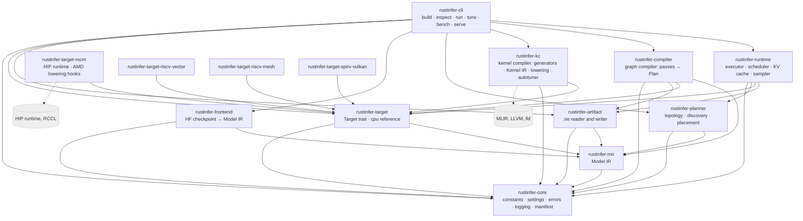
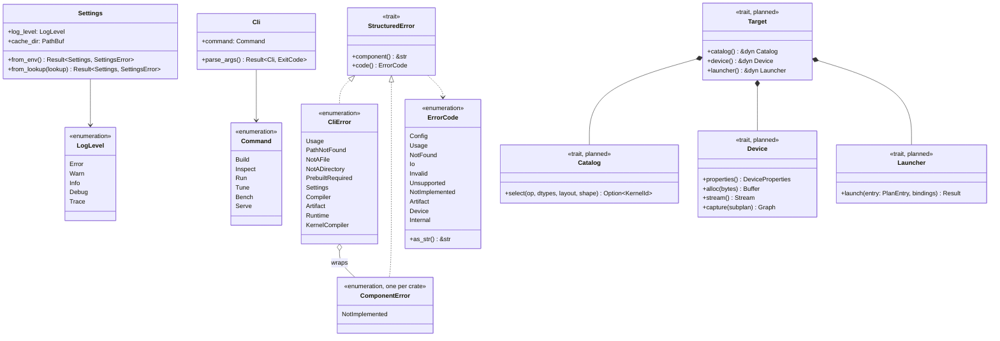
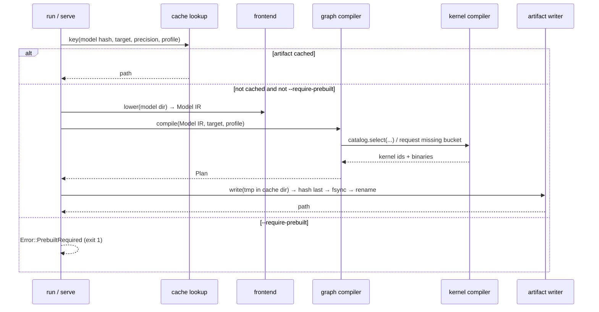
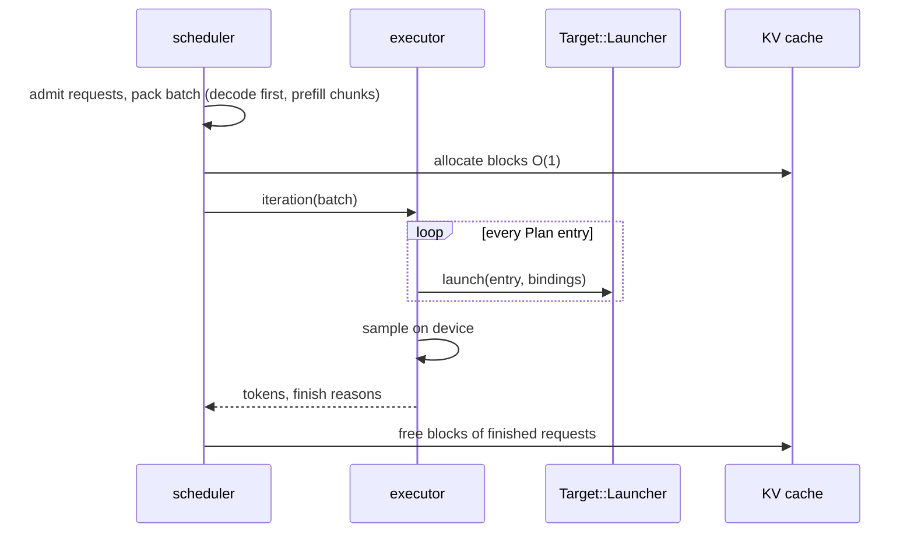
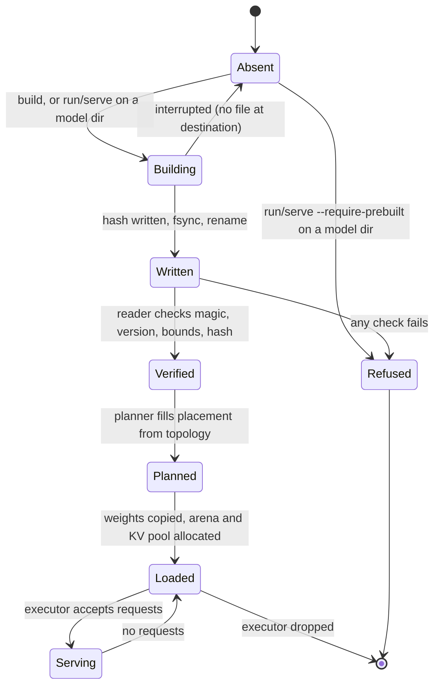
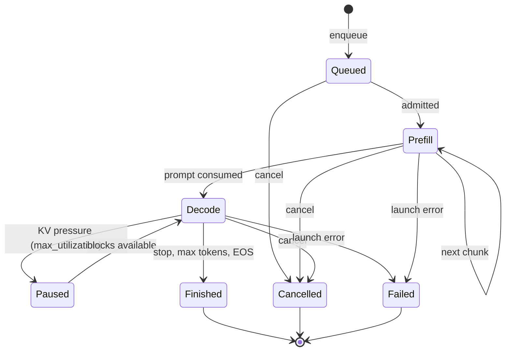
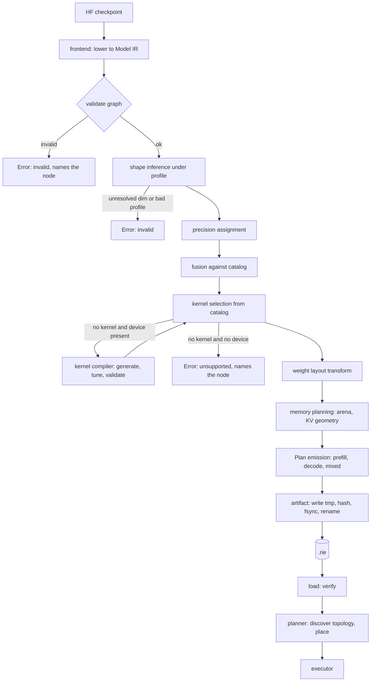
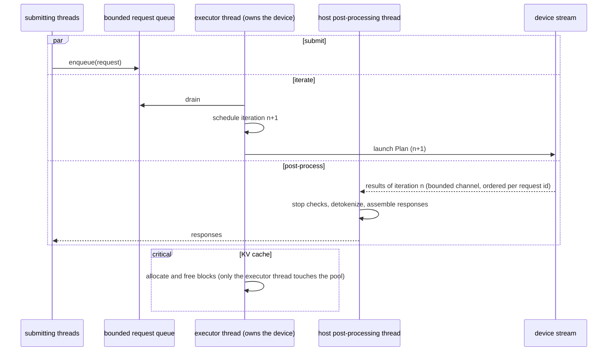

<!-- Generated by scripts/reference/gen_diagrams.py from the rustinfer checkout; do not edit by hand. Regenerate with `.venv/bin/python scripts/reference/gen_diagrams.py`. -->
# Design diagrams

Copied from `docs/uml/*.md` at commit db6d252 2026-11-10. SWG-001 §17.3 requires each
diagram file to carry a header naming the date, author and pull request of its
last update, and the tree's CI checks that header (`scripts/ci/check_doc_freshness.py`)
and that every Mermaid block parses (`scripts/ci/validate_mermaid.py`). The
headers are reproduced below each title. Items the diagrams mark *planned* have
no code behind them yet; the [design](design.html) page says which do.

## Component Diagram

*component diagram, last updated 2026-11-10 by @itej89 in PR #2.*

Each box is one crate under `crates/`; the source tree mirrors this diagram
(SWG-001 §5.9.3). Arrows are Cargo dependencies and point downward only.



In R1 only `rustinfer-core` and `rustinfer-cli` carry behaviour; every other
crate has its error type and public surface so the dependency graph is fixed
from the first commit (G22: logical dependencies made physical).

## Class Diagram

*class diagram, last updated 2026-11-10 by @itej89 in PR #2.*

The R1 types with behaviour, plus the R1 shape of the interfaces the SRS fixes
(ADR-003, ADR-005). Items marked *planned* have no code yet.



## Sequence Diagrams

*sequence diagram, last updated 2026-11-10 by @itej89 in PR #2.*

### 1. Command start (RI-CLI-010, RI-CLI-011) — implemented in R1

```mermaid
sequenceDiagram
    participant U as User
    participant M as main
    participant C as cli::Cli
    participant S as core::Settings
    participant L as core::logging
    participant V as core::manifest
    participant D as commands::dispatch
    U->>M: rustinfer <subcommand> args
    M->>C: parse_args()
    C-->>M: Command (or exit 0 for --help/--version, exit 2 on usage)
    M->>S: from_env()
    S-->>M: Settings (or SettingsError → exit 1)
    M->>L: configure(level)
    M->>V: log_version_manifest(name, version)
    V-->>U: stderr: ts=… level=info component=manifest startup="version_manifest" …
    M->>D: dispatch(command, settings)
    D->>D: validate paths (RI-CLI-012)
    D-->>M: Ok | Error
    M-->>U: stderr: error=<code> component=<name> detail="…" ; exit 1
```

### 2. Build on first load (RI-CLI-003, RI-ART-004) — R1 design, implemented with the artifact



### 3. One decode iteration (RI-RT-002) — R2



## State Diagrams

*state diagram, last updated 2026-11-10 by @itej89 in PR #2.*

### Artifact lifecycle (RI-ART, RI-CLI-003, RI-CLI-004)



### Request lifecycle (RI-RT, RI-SCH) — R2



## Activity Diagram: the build pipeline

*activity diagram, last updated 2026-11-10 by @itej89 in PR #2.*

The graph compiler's pass order (RI-GC-001 to RI-GC-008) and where the kernel
compiler and planner enter.



## Concurrency Diagram

*concurrency diagram, last updated 2026-11-10 by @itej89 in PR #2.*

R1 has one thread: the command runs sequentially (RI-CON-001). The diagram
records the R2 design so the R1 types are shaped for it (RI-CON-002, RI-CON-003).



Rules: device buffers are touched only by the executor thread; the queue and
the result channel are bounded; a failure on the host side marks requests
failed and frees their blocks on the executor thread, never from the host.

