<!-- Generated by scripts/reference/gen_diagrams.py from the rustinfer checkout; do not edit by hand. Regenerate with `.venv/bin/python scripts/reference/gen_diagrams.py`. -->
# Design diagrams

Copied from `docs/uml/*.md` at commit f039b4d 2026-11-12. SWG-001 §17.3 requires each
diagram file to carry a header naming the date, author and pull request of its
last update, and the tree's CI checks that header (`scripts/ci/check_doc_freshness.py`)
and that every Mermaid block parses (`scripts/ci/validate_mermaid.py`). The
headers are reproduced below each title. Items the diagrams mark *planned* have
no code behind them yet; the [design](design.html) page says which do.

## Component Diagram

*component diagram, last updated 2026-11-12 by @itej89 in PR #5.*

Each box is one crate under `crates/`; the source tree mirrors this diagram
(SWG-001 §5.9.3). Arrows are Cargo dependencies and point downward only.

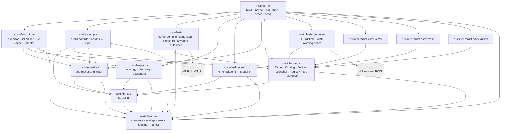

`rustinfer-core`, `rustinfer-cli`, `rustinfer-mir`, `rustinfer-artifact`,
`rustinfer-planner` and `rustinfer-target` carry behaviour; every other crate has
its error type and public surface so the dependency graph is fixed from the
first commit (G22: logical dependencies made physical). `rustinfer-mir` depends
on `serde` and `serde_json` for the canonical JSON form; `rustinfer-artifact` on
the same plus `sha2` for the content hash (external, not drawn).
`rustinfer-planner` carries behaviour from PR #15 (topology model, placement
types, single-device planner) and depends on `rustinfer-mir` for the document
it fills and on `serde` and `serde_json` for the `topology` and `placement`
sections; it depends on no target or artifact crate.

The command is the composition root of the target registry (ADR-003,
RI-TGT-004): it depends on every backend crate and registers each crate's one
`TargetEntry`; the compiler, planner and runtime see only `rustinfer-target`.
The four backend crates implement `Target` with an empty catalog and no device
until their hardware issues land (#12 and the RISC-V milestones).

## Class Diagram

*class diagram, last updated 2026-11-12 by @itej89 in PR #5.*

The R1 types with behaviour of the scaffold and the command.

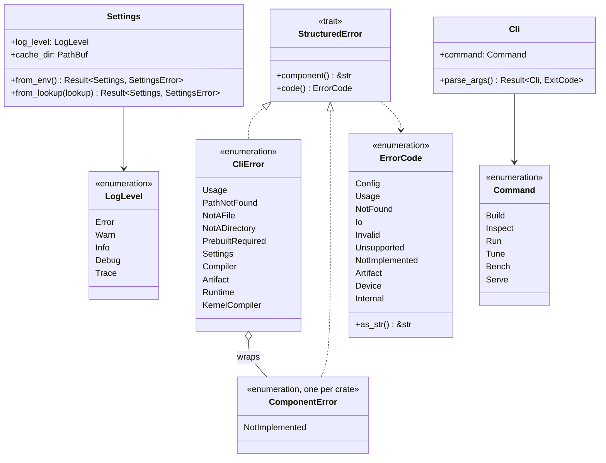

The `Target` trait family is drawn in its own section below (PR #5).

### Model IR (`rustinfer-mir`, SRS §3.2.3, PR #3)

The typed SSA graph every frontend lowers to and every backend consumes. Data
types are plain structs with public fields and derive `Serialize`/`Deserialize`;
behaviour lives in `Document` (validation, canonical JSON), the operator registry
(a static table, one row per operator) and the bounded reader. Every type is
`Send + Sync` by construction (no interior mutability).


Validation order (RI-MIR-006), first failure wins and names the function, node
and field: version → function names → profile-independent shape and name checks
→ duplicate definitions across weights, inputs and node outputs → undefined
inputs → cycle (Kahn) and definition-before-use order → operator release, arity
and dtype rules from the registry → KV group presence → encoding consistency →
function outputs defined.

### Engine artifact (`rustinfer-artifact`, SRS §3.2.7, ADR-002, PR #4)

The `.rie` file: a fixed header, a section table and nine sections. `Sections`
is the typed content (what a build produces and a load consumes); `Writer`
turns it into bytes atomically; `Artifact` is the verifying reader, which
exposes a section only after magic, version, header length, every bound and
the hash have passed (RI-ART-003, RI-SEC-002). The `weights` section is a
manifest: the artifact holds no weight byte (RI-ART-012). Every type is
`Send + Sync`; the reader is read-only and the writer owns its temporary file.

```mermaid
classDiagram
    class Artifact {
        -bytes: Vec~u8~
        -header: Header
        +read(path) Result~Artifact~
        +read_with_limits(path, limits) Result~Artifact~
        +from_bytes(bytes) Result~Artifact~
        +from_bytes_with_limits(bytes, limits) Result~Artifact~
        +header() &Header
        +section_bytes(name) &[u8]
        +model_ir() Result~Document~
        +plan() Result~PlanSection~
        +profile() Result~Profile~
        +metadata() Result~Metadata~
        +catalog() Result~Catalog~
        +kernels() Result~Kernels~
        +weights() Result~WeightManifest~
        +topology() &[u8]
        +placement() &[u8]
        +sections() Result~Sections~
    }
    class Writer {
        -target: String
        -producer: String
        +new(target, producer) Result~Writer~
        +temporary_path(path) PathBuf
        +write(sections, path) Result~Sha256~
        +write_with_limits(sections, path, limits) Result~Sha256~
        +to_bytes(sections) Result~Vec~u8~~
        +to_bytes_with_limits(sections, limits) Result~Vec~u8~~
        +to_bytes_raw(raw) Vec~u8~
    }
    class RawSections {
        -bytes: [Vec~u8~; 9]
        +get(name) &[u8]
        +set(name, bytes)
    }
    class Header {
        +format_version: u16
        +header_length: u16
        +target: String
        +producer: String
        +hash: Sha256
        +sections: Vec~SectionEntry~
    }
    class SectionEntry {
        +name: SectionName
        +offset: u64
        +length: u64
        +alignment: u32
    }
    class SectionName {
        <<enumeration, the nine names of RI-ART-002 in order>>
        ModelIr
        Plan
        Profile
        Metadata
        Catalog
        Kernels
        Weights
        Topology
        Placement
        +as_str() &str
        +parse(name) Option~SectionName~
    }
    class Sha256 {
        +bytes: [u8; 32]
        +of(bytes) Sha256
        +to_hex() String
    }
    class Limits {
        +max_file_bytes: u64
        +max_sections: usize
        +max_json_section_bytes: usize
        +max_kernels: usize
        +max_catalog_entries: usize
        +max_plan_entries_per_function: usize
        +max_weights: usize
        +max_ranks_per_weight: usize
        +max_string_length: usize
    }
    class Sections {
        +model_ir: Document
        +plan: PlanSection
        +profile: Profile
        +metadata: Metadata
        +catalog: Catalog
        +kernels: Kernels
        +weights: WeightManifest
        +topology: Vec~u8~
        +placement: Vec~u8~
        +validate(target, limits) Result~()~
        +encode() Result~RawSections~
    }
    class PlanSection {
        +functions: BTreeMap~String, Plan~
        +function_names() Iterator~&str~
    }
    class Plan {
        +entries: Vec~PlanEntry~
    }
    class PlanEntry {
        +node: String
        +kernel: String
    }
    class ShapeQuery {
        +batch: u64
        +num_tokens: u64
        +seq_len: u64
        +beam: u64
        +check(profile) Result~()~
    }
    class Metadata {
        +producer: String
        +rustc_version: String
        +llvm_version: String
        +catalog_version: String
        +build_options: BTreeMap~String, String~
        +checkpoint: CheckpointIdentity
        +origin: Origin
        +timestamp: String
    }
    class Origin {
        <<enumeration>>
        Build
        FirstLoad
    }
    class CheckpointIdentity {
        +config_sha256: Sha256
        +files: BTreeMap~String, FileIdentity~
        +verify(observed) Result~()~
    }
    class FileIdentity {
        +size: u64
        +header_sha256: Sha256
    }
    class Catalog {
        +entries: Vec~CatalogEntry~
        +lookup(key) Option~&CatalogEntry~
    }
    class CatalogEntry {
        +key: CatalogKey
        +kernel: String
        +parameters: BTreeMap~String, u64~
    }
    class CatalogKey {
        +target: String
        +generator_version: String
        +shape_bucket: String
    }
    class Kernels {
        +entries: BTreeMap~String, KernelEntry~
    }
    class KernelEntry {
        +target: String
        +binary: Vec~u8~
        +kernel_ir: Vec~u8~
    }
    class WeightManifest {
        +checkpoint: CheckpointRef
        +weights: BTreeMap~String, WeightEntry~
    }
    class CheckpointRef {
        +format: CheckpointFormat
        +root: String
    }
    class CheckpointFormat {
        <<enumeration>>
        Safetensors
    }
    class WeightEntry {
        +file: String
        +tensor: String
        +dtype: DType
        +shape: Vec~u64~
        +source_layout: String
        +byte_range: ByteRange
        +target_layout: String
        +transform: String
        +ranks: Vec~u32~
    }
    class ByteRange {
        +offset: u64
        +length: u64
    }
    class ArtifactError {
        <<enumeration: Io, Busy, TooLarge, Truncated, BadMagic, UnsupportedVersion, BadHeaderLength, BadHeaderField, WrongSectionCount, UnknownSection, SectionOrder, SectionOutOfFile, SectionsOverlap, BadSectionEntry, HashMismatch, MalformedSection, ModelIr, InvalidKernel, InvalidField, Inconsistent, DuplicateCatalogKey, OutsideProfile, CheckpointMismatch, NotImplemented>>
    }
    Artifact *-- Header
    Header *-- SectionEntry
    Header *-- Sha256
    SectionEntry *-- SectionName
    Artifact ..> Limits : reader bounds
    Artifact ..> Sections : parses and cross-checks
    Writer ..> Sections : validates and serialises
    Sections ..> RawSections : encode
    Writer ..> RawSections : lays out
    Writer ..> Sha256 : hash written last
    Sections *-- Document : model_ir (rustinfer-mir)
    Sections *-- PlanSection
    Sections *-- Profile : profile (rustinfer-mir)
    Sections *-- Metadata
    Sections *-- Catalog
    Sections *-- Kernels
    Sections *-- WeightManifest
    PlanSection *-- Plan
    Plan *-- PlanEntry
    ShapeQuery ..> Profile : check
    Metadata *-- Origin
    Metadata *-- CheckpointIdentity
    CheckpointIdentity *-- FileIdentity
    CheckpointIdentity *-- Sha256
    Catalog *-- CatalogEntry
    CatalogEntry *-- CatalogKey
    Kernels *-- KernelEntry
    WeightManifest *-- CheckpointRef
    WeightManifest *-- WeightEntry
    CheckpointRef *-- CheckpointFormat
    WeightEntry *-- ByteRange
    WeightEntry *-- DType : rustinfer-mir
    Artifact ..> ArtifactError
    Writer ..> ArtifactError
    StructuredError <|.. ArtifactError
```

Reader check order (RI-ART-003, RI-SEC-002), first failure wins and names the
check: file size bound → fixed header present → magic → version in the accepted
set → section count bound → header length → target and producer ASCII → table
(known names in the fixed order, each entry inside the file, aligned, reserved
field zero, no overlap) → SHA-256 of every byte after the header → sections
exposed. Typed sections are parsed on demand with `deny_unknown_fields`;
`sections()` parses all of them and cross-checks: one Plan per Model IR
function naming existing nodes and kernels, manifest keys equal to the Model IR
weight names, every manifest file in the checkpoint identity with its byte range
inside the recorded size, every catalog kernel present, every kernel with a
non-empty binary and Kernel IR (RI-ART-013).

Kernels section layout: `u64 LE index length`, the canonical JSON index
(`{"entries":{"<id>":{"target":…,"binary":[offset,length],"kernel_ir":[offset,length]}}}`,
offsets relative to the end of the index), then the concatenated blobs. Every
range is bounded by the section before it is sliced.
### Topology planner (`rustinfer-planner`, SRS §3.2.6, PR #15)

The R1 surface: the topology model of RI-PLN-001 (devices, memory tiers,
links, offload engines; JSON in and out under its own version), the
`Placement` that fills the Model IR's placement and device slots (RI-MIR-005)
and serialises to the artifact's `placement` section (RI-PLN-005), the
`Planner` trait every placement strategy implements, and the single-device
planner. Discovery (RI-PLN-002) and the cost-model planner (RI-PLN-003,
RI-PLN-006) are reserved interface points that return `not_implemented`.
Indices (`local_tier`, `endpoints`, `device`) point into the topology's own
lists; a placement's device indices point into the topology's device list.
Every type is `Send + Sync` (no interior mutability).

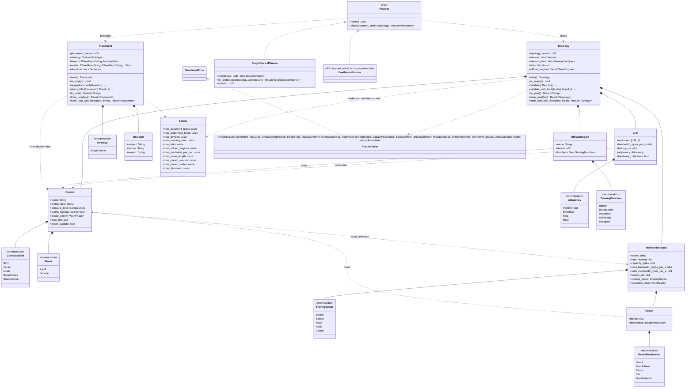

`place(document, profile, topology, planner)` is the one call the rest of R1
makes: it validates the three inputs, asks the planner for a `Placement`,
applies it to the document and checks that no slot is left empty. The
single-device planner puts every tensor in the selected device's local tier and
every node on that device, and refuses with `capacity_exceeded` when the
document's footprint at the profile's `max` (weights plus the largest
function's inputs and outputs, element count times element size) exceeds the
tier's capacity. `discover()` (RI-PLN-002) returns `not_implemented` in R1.

### Target abstraction (`rustinfer-target`, SRS §3.2.8, ADR-003, PR #5)

One trait, `Target`, composed of three object-safe capabilities. `Catalog` is
device-free (the graph compiler holds `&dyn Catalog`); `Device` owns memory,
streams, events, copies and graph segments; `Launcher` executes one resolved
launch. A backend crate implements all three and exposes one `TargetEntry`; the
command's composition root registers every entry in a `Registry` keyed by
architecture string only (RI-TGT-001). The CPU reference target lives in this
crate (`cpu` module); the four device backends are stubs with an `EmptyCatalog`
and no device (RI-RV-001).

```mermaid
classDiagram
    class Registry {
        +new() Registry
        +register(entry: TargetEntry) Result~()~
        +architectures() Vec~&str~
        +contains(architecture) bool
        +resolve(architecture) Result~Box~dyn Target~~
    }
    class TargetEntry {
        +architectures: &[&str]
        +build: fn(&str) Result~Box~dyn Target~~
    }
    class Target {
        <<trait: Send + Sync>>
        +architecture() &str
        +catalog() &dyn Catalog
        +devices() Vec~DeviceProperties~
        +device(index) Result~&dyn Device~
        +launcher(index) Result~&dyn Launcher~
    }
    class Catalog {
        <<trait: Send + Sync>>
        +architecture() &str
        +entries() &[KernelEntry]
        +select(query: &KernelQuery) Result~&KernelEntry~
    }
    class Device {
        <<trait: Send + Sync>>
        +properties() &DeviceProperties
        +alloc(bytes) Result~Buffer~
        +free(buffer: BufferId) Result~()~
        +create_stream() Result~StreamId~
        +create_event() Result~EventId~
        +record(event, stream) Result~()~
        +wait(stream, event) Result~()~
        +copy_to_device(dst: BufferRange, src: &[u8], stream) Result~()~
        +copy_to_host(src: BufferRange, dst: &mut [u8], stream) Result~()~
        +copy_on_device(dst, src, stream) Result~()~
        +synchronize(stream) Result~()~
        +synchronize_event(event) Result~()~
        +capture(stream, bucket, launches: &[Launch]) Result~Graph~
        +replay(graph: &Graph, stream) Result~()~
        +sync_counters() SyncCounters
        +reset_sync_counters()
    }
    class Launcher {
        <<trait: Send + Sync>>
        +load(binary: &KernelBinary) Result~()~
        +launch(launch: &Launch, stream) Result~()~
    }
    class KernelEntry {
        +id: KernelId
        +op: OpKind
        +dtypes: Vec~DType~
        +layout: Layout
        +shape_rules: Vec~ShapeRule~
        +cost: KernelCost
        +validation: Option~Validation~
        +parameters: BTreeMap~String, u64~
        +matches(query, architecture) bool
    }
    class KernelQuery {
        +op: OpKind
        +dtype: DType
        +layout: Layout
        +bucket: Bucket
    }
    class KernelCost {
        <<enumeration>>
        Untuned
        Measured(microseconds)
    }
    class ShapeRule {
        <<enumeration>>
        MultipleOf(dim, of)
        AtLeast(dim, min)
        AtMost(dim, max)
        +holds(bucket) bool
    }
    class Validation {
        +architecture: String
        +driver_version: String
        +date: String
    }
    class KernelBinary {
        +id: KernelId
        +architecture: String
        +format: BinaryFormat
        +bytes: Vec~u8~
        +kernel_ir: Option~String~
    }
    class BinaryFormat {
        <<enumeration>>
        Native
        HsaCodeObject
        SpirV
        RiscvElf
    }
    class EmptyCatalog {
        +new(architecture) EmptyCatalog
    }
    class DeviceProperties {
        +architecture: String
        +name: String
        +index: u32
        +memory_bytes: u64
        +compute_units: u32
    }
    class Buffer {
        +id: BufferId
        +bytes: u64
        +range() BufferRange
        +slice(offset, len) Result~BufferRange~
    }
    class BufferRange {
        +buffer: BufferId
        +offset: u64
        +len: u64
    }
    class Arena {
        +new(device, bytes) Result~Arena~
        +buffer() &Buffer
        +region(offset, len) Result~BufferRange~
        +release(device) Result~()~
    }
    class SyncCounters {
        +stream_synchronizations: u64
        +event_synchronizations: u64
        +readbacks: u64
        +total() u64
    }
    class Launch {
        +kernel: KernelId
        +op: Op
        +inputs: Vec~Operand~
        +outputs: Vec~Operand~
        +host_sync: HostSync
    }
    class Operand {
        +range: BufferRange
        +dtype: DType
        +shape: Vec~u64~
        +elements() u64
    }
    class HostSync {
        <<enumeration>>
        No
        Required
    }
    class Bucket {
        +batch: u64
        +num_tokens: u64
    }
    class Graph {
        +bucket: Bucket
        +segments: Vec~Segment~
    }
    class Segment {
        +launches: Vec~Launch~
        +host_sync_after: bool
    }
    class CpuTarget {
        +new() CpuTarget
        +with_memory_limit(bytes) CpuTarget
        +entry() TargetEntry
    }
    class CpuCatalog {
        <<one entry per R1 compute operator, cpu.&lt;op&gt;>>
    }
    class CpuDevice {
        -memory: Mutex~Memory~
        -counters: atomics
    }
    class reference {
        <<module: fp32 oracle functions>>
        +embedding() +matmul() +rmsnorm() +layernorm() +rope()
        +attention_prefill() +attention_decode_paged() +kv_cache_write()
        +silu_and_mul() +gelu_and_mul() +residual_add() +quantize()
        +dequantize() +logits_head() +sample()
    }
    class numeric {
        <<module: element conversions, round to nearest even>>
        +bf16 +fp16 +fp8_e4m3 +fp8_e4m3fnuz
    }
    class TargetError {
        <<enumeration: CatalogEmpty, NoKernel, UnknownArchitecture, InvalidArchitecture, DuplicateArchitecture, NoDevice, OutOfMemory, InvalidAllocation, UnknownBuffer, OutOfBounds, BufferBusy, UnknownStream, UnknownEvent, UnknownKernel, UnsupportedBinary, OperandMismatch, UnsupportedDtype, IndexOutOfRange, NotImplemented>>
    }
    Registry o-- TargetEntry
    TargetEntry ..> Target : builds
    Target *-- Catalog
    Target *-- Device
    Target *-- Launcher
    Catalog o-- KernelEntry
    Catalog ..> KernelQuery
    KernelEntry *-- KernelCost
    KernelEntry *-- ShapeRule
    KernelEntry *-- Validation
    KernelBinary *-- BinaryFormat
    Catalog <|.. EmptyCatalog
    Catalog <|.. CpuCatalog
    Device <|.. CpuDevice
    Launcher <|.. CpuTarget
    Target <|.. CpuTarget
    CpuTarget *-- CpuCatalog
    CpuTarget *-- CpuDevice
    CpuTarget ..> reference : launch decodes, calls, encodes
    CpuTarget ..> numeric
    Device ..> DeviceProperties
    Device ..> Buffer
    Buffer ..> BufferRange
    Arena *-- Buffer
    Device ..> SyncCounters
    Launcher ..> Launch
    Launcher ..> KernelBinary
    Launch *-- Operand
    Launch *-- HostSync
    Operand *-- BufferRange
    Graph *-- Segment
    Graph *-- Bucket
    Segment *-- Launch
    KernelQuery *-- Bucket
    StructuredError <|.. TargetError
```

Operand conventions of the CPU launcher (also the convention a Plan resolves
to): `inputs` in the order RI-MIR-004 lists them, then for `kv_cache_write`
and `attention_decode_paged` the key and value pools
(`[num_blocks, block_size, num_kv_heads, head_dim]`); `outputs` in the
operator's order, `kv_cache_write` writing the two pools as its outputs and
`quantize` always producing `quantized, scale`. Every float operand is decoded
to `f32`, every integer operand to `i64`, the operator runs in `f32`, and the
result is encoded into the output dtype with round-to-nearest-even
(RI-TGT-003). `fused` has no CPU kernel: its reference value is its parts run
in order, so the compiler never fuses for `cpu` (RI-GC-003).

## Sequence Diagrams

*sequence diagram, last updated 2026-11-12 by @itej89 in PR #5.*

### 1. Command start (RI-CLI-010, RI-CLI-011) — implemented in R1

```mermaid
sequenceDiagram
    participant U as User
    participant M as main
    participant C as cli::Cli
    participant S as core::Settings
    participant L as core::logging
    participant V as core::manifest
    participant D as commands::dispatch
    U->>M: rustinfer <subcommand> args
    M->>C: parse_args()
    C-->>M: Command (or exit 0 for --help/--version, exit 2 on usage)
    M->>S: from_env()
    S-->>M: Settings (or SettingsError → exit 1)
    M->>L: configure(level)
    M->>V: log_version_manifest(name, version)
    V-->>U: stderr: ts=… level=info component=manifest startup="version_manifest" …
    M->>D: dispatch(command, settings)
    D->>D: validate paths (RI-CLI-012)
    D-->>M: Ok | Error
    M-->>U: stderr: error=<code> component=<name> detail="…" ; exit 1
```

### 2. Build on first load (RI-CLI-003, RI-ART-004) — R1 design, implemented with the artifact

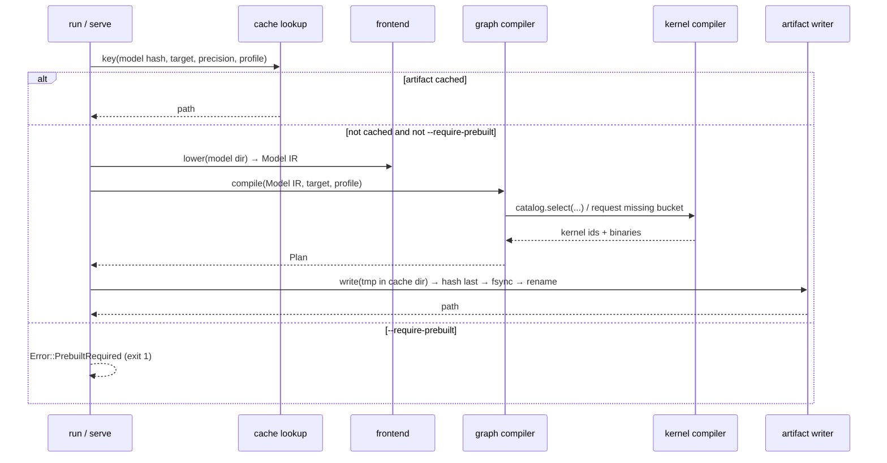

### 3. One decode iteration (RI-RT-002) — R2

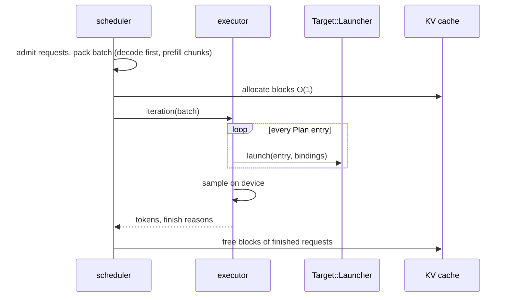

### 4. Model IR document in and out (RI-MIR-006, RI-MIR-007, RI-MIR-008) — implemented in R1

The JSON reader is an external boundary (SWG-001 §8.7): the text is bounded,
parsed into an untyped tree, scanned for version, counts and names, and only
then turned into the typed graph and validated. Every refusal is one `mir`
error with a code, logged as `key=value` at `error`.

```mermaid
sequenceDiagram
    participant C as caller (frontend, artifact reader)
    participant D as mir::Document
    participant S as mir::json::scan
    participant J as serde_json
    participant V as mir::validate
    participant R as mir::registry
    C->>D: from_json(text)
    D->>S: check len ≤ max_document_bytes
    S-->>D: Error::TooLarge (code invalid)
    D->>J: from_str::<Value>(text) (depth bounded by serde_json)
    J-->>D: Error::Malformed (code invalid), logged stage=read boundary=model_ir_json
    D->>S: ir_version in supported set
    S-->>D: Error::UnsupportedVersion{version, supported} (code unsupported)
    D->>S: counts ≤ Limits; operator, dtype, dimension, encoding names; kv_group present
    S-->>D: Error naming node or tensor and field (code invalid)
    D->>J: from_value::<Document>(value)
    J-->>D: Error::Malformed (missing field, wrong type, unknown field)
    D->>V: validate_with_limits(document, limits)
    V->>R: spec(op): release, arity, dtype rules
    V-->>D: first failure naming function, node, field
    D-->>C: Document (typed, immutable by convention) or Error
    C->>D: to_json()
    D->>V: validate()
    D->>J: to_value (BTreeMap keys) then to_string (compact)
    D-->>C: canonical text: sorted keys, exact integers, shortest round-trip reals
```

### 5. Artifact write (RI-ART-004, RI-NFR-007) — implemented in R1

The writer validates the typed sections first (nothing is created for an
invalid build), streams to a temporary file in the destination directory,
writes the hash last, `fsync`s, and renames. Any failure removes the temporary
file; the destination is never half-written.

```mermaid
sequenceDiagram
    participant B as build / first load
    participant W as artifact::Writer
    participant S as artifact::Sections
    participant E as artifact::encode
    participant F as <out>.tmp-<pid>
    participant H as sha2::Sha256
    B->>W: write(sections, out)
    W->>S: validate(target)
    S-->>W: Error naming section, item and field (nothing created)
    W->>E: encode sections → bytes, table, header (hash zero)
    W->>F: create_new in out's directory
    W->>F: write header, sections and alignment padding
    W->>H: hash every byte after the header
    W->>F: seek to offset 72, write the hash
    W->>F: sync_all
    W->>F: rename to out
    F-->>B: Error::Io{op, path}, temporary file removed
    W-->>B: Sha256 of the content; log stage=write status=done bytes=… hash=…
```

### 6. Artifact read and verify (RI-ART-003, RI-SEC-002, RI-ART-012) — implemented in R1

The artifact file is an external boundary (SWG-001 §8.7): every length is
bounded by the file size, no allocation is sized by an untrusted field before
its bound check, and no section is exposed before the hash passes. Each refusal
is one `artifact` error naming the failed check, logged once at `error` as
`stage=read boundary=artifact_file reason=…`.

```mermaid
sequenceDiagram
    participant C as inspect / run
    participant A as artifact::Artifact
    participant D as artifact::decode
    participant H as sha2::Sha256
    participant M as mir::Document
    participant S as artifact::Sections
    C->>A: read(path)
    A->>A: file size ≤ max_file_bytes (before reading)
    A->>D: magic, version ∈ accepted, section_count ≤ max, header_length = 112 + 40·count ≤ size
    D-->>A: Error::BadMagic | UnsupportedVersion | TooLarge | BadHeaderLength
    A->>D: target and producer: NUL-padded printable ASCII
    A->>D: table: known names in order, offset ≥ header_length, offset + length ≤ size (checked), aligned, reserved zero, no overlap
    D-->>A: Error::UnknownSection | SectionOrder | SectionOutOfFile | SectionsOverlap | BadSectionEntry
    A->>H: sha256(bytes[header_length..]) == header.hash
    H-->>A: Error::HashMismatch{expected, found}
    A-->>C: Artifact (sections addressable, nothing parsed yet)
    C->>A: plan() / profile() / metadata() / catalog() / kernels() / weights()
    A->>D: bounded canonical JSON, deny_unknown_fields; kernels index ranges inside the section
    D-->>A: Error::MalformedSection{section, detail} | InvalidKernel
    C->>A: model_ir()
    A->>M: Document::from_json(section) (its own bounds, RI-MIR-008)
    C->>A: sections()
    A->>S: validate(header.target): cross-references of plan, kernels, catalog, manifest and identity
    S-->>C: Error::Inconsistent{section, item, reason}
    C->>S: metadata.checkpoint.verify(observed identity)
    S-->>C: Error::CheckpointMismatch{file, reason} naming the first differing file
### 7. Placing a Model IR document on one device (RI-PLN-001, RI-PLN-005, RI-MIR-005) — implemented in R1

The topology JSON reader is an external boundary (SWG-001 §8.7): a pinned
topology file or, from R2, the discovered node. The text is bounded, the
version is read before any other field, the typed structure is built with
unknown fields refused, and every index and range is validated naming the
field. The planner itself takes validated inputs only.

```mermaid
sequenceDiagram
    participant C as caller (build, run)
    participant T as planner::Topology
    participant J as serde_json
    participant V as planner::topology::validate
    participant P as planner::place
    participant S as SingleDevicePlanner
    participant D as mir::Document
    participant L as planner::Placement
    C->>T: from_json(text)
    T->>T: len ≤ max_document_bytes else Error::TooLarge
    T->>J: from_str::<Value>(text) (depth bounded)
    J-->>T: Error::Malformed, logged stage=read boundary=topology_json
    T->>T: topology_version in supported set else Error::UnsupportedVersion
    T->>J: from_value::<Topology> (deny_unknown_fields)
    T->>V: counts ≤ Limits; names; indices; ranges
    V-->>T: Error::InvalidField{field} | DuplicateName | TooLarge
    T-->>C: Topology
    C->>P: place(&mut document, &profile, &topology, &planner)
    P->>D: validate()
    P->>T: validate()
    P->>S: plan(&document, &profile, &topology)
    S->>S: device index in topology else Error::UnknownDevice
    S->>D: footprint at profile max (Shape::max_elements × element_bytes)
    S->>S: footprint ≤ local tier capacity else Error::CapacityExceeded
    S-->>P: Placement{strategy=single_device, tensors, nodes, decisions}
    P->>L: apply(&mut document)
    L->>D: fill every PlacementSlot and DeviceSlot
    P->>L: check_filled(&document)
    L-->>P: Error::UnplacedTensor | Error::UnplacedNode (none after a successful apply)
    P-->>C: Placement (serialised into the artifact's placement section)

### 8. Target selection and one CPU launch (RI-TGT-001, RI-TGT-002, RI-TGT-003) — implemented in R1

The architecture string is the one external input of the target crate (the
`--target` argument): it is validated at the registry boundary (length,
character set) before any lookup, and a product name is never mapped. The
launch path shows the CPU reference target; a device backend replaces the
decode-compute-encode step with a kernel enqueue.

```mermaid
sequenceDiagram
    participant C as cli::targets (composition root)
    participant R as target::Registry
    participant T as dyn Target (cpu)
    participant K as dyn Catalog
    participant D as dyn Device (cpu)
    participant L as dyn Launcher (cpu)
    participant F as cpu::reference
    C->>R: register(cpu, rocm, riscv-vector, riscv-mesh, spirv-vulkan entries)
    C->>R: resolve("gfx950")
    R->>R: validate string (non-empty, ≤ 64, [A-Za-z0-9_-])
    R-->>C: Error::InvalidArchitecture | Error::UnknownArchitecture{known} (logged stage=resolve boundary=architecture_string)
    R-->>C: Box<dyn Target>
    C->>T: catalog()
    T-->>C: &dyn Catalog
    C->>K: select(KernelQuery{op, dtype, layout, bucket})
    K-->>C: Error::CatalogEmpty{target} (stub) | Error::NoKernel | &KernelEntry (cheapest validated match)
    C->>T: device(0)
    T-->>C: Error::NoDevice (stub) | &dyn Device
    C->>D: alloc(bytes) ×n, copy_to_device(range, bytes, stream)
    C->>L: launch(Launch{kernel, op, inputs, outputs, host_sync}, stream)
    L->>L: validate kernel id, operand counts, dtypes, shapes, ranges in bounds
    L-->>C: Error::UnknownKernel | OperandMismatch | OutOfBounds (logged stage=launch)
    L->>D: check out the distinct buffers (memory mutex held only here)
    L->>F: decode operands to f32/i64, run the operator, encode outputs
    L->>D: check the buffers back in
    L-->>C: Ok
    C->>D: copy_to_host(range, &mut bytes, stream) — counted as a readback
    C->>D: sync_counters()
    D-->>C: SyncCounters{stream, event, readbacks}
```

## State Diagrams

*state diagram, last updated 2026-11-12 by @itej89 in PR #4.*

### Artifact lifecycle (RI-ART, RI-CLI-003, RI-CLI-004)

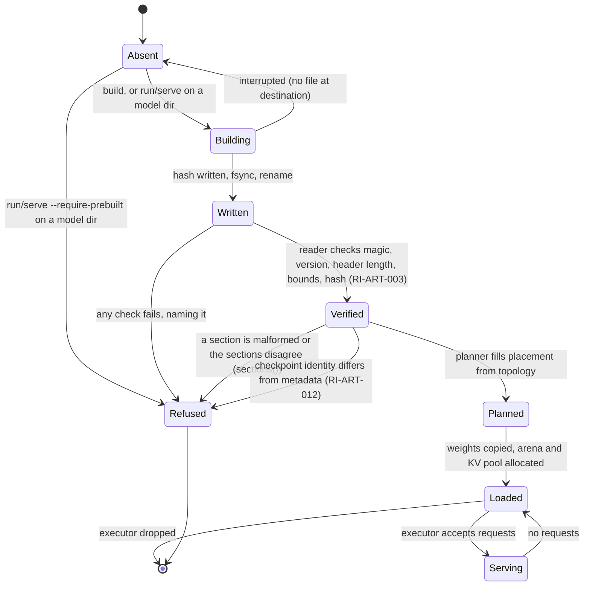

### Request lifecycle (RI-RT, RI-SCH) — R2

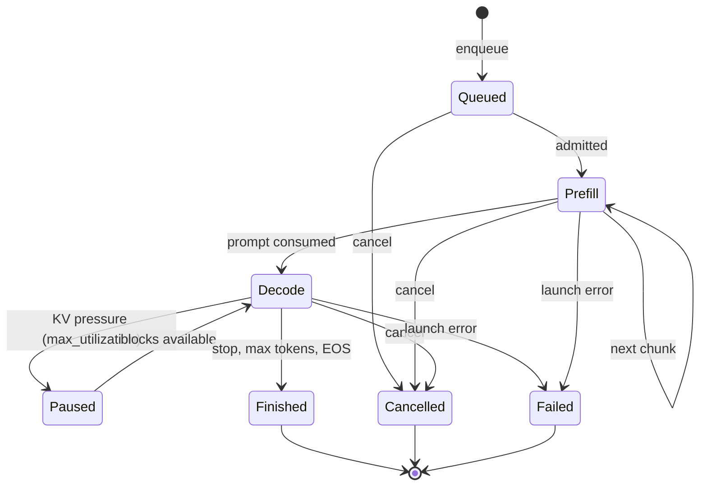

## Activity Diagram: the build pipeline

*activity diagram, last updated 2026-11-10 by @itej89 in PR #2.*

The graph compiler's pass order (RI-GC-001 to RI-GC-008) and where the kernel
compiler and planner enter.

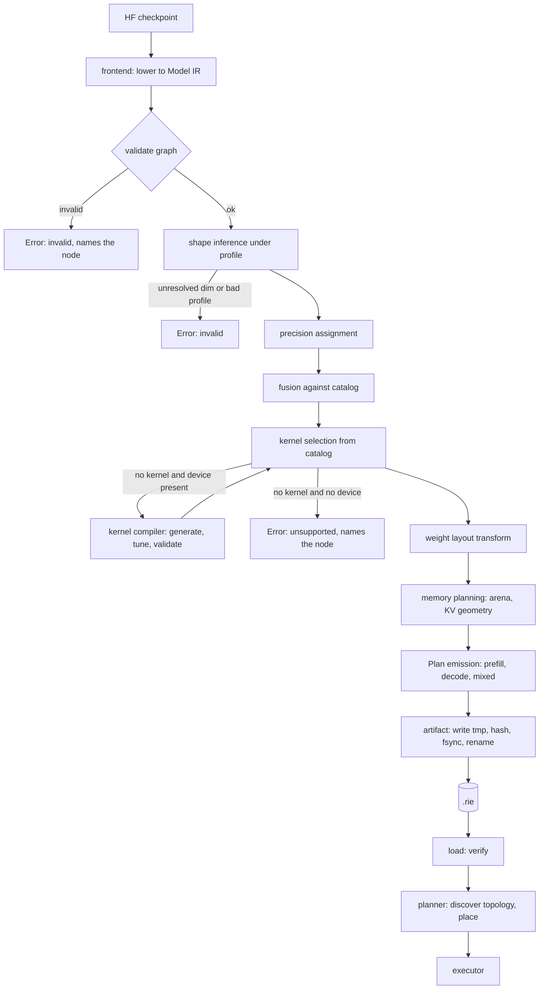

## Concurrency Diagram

*concurrency diagram, last updated 2026-11-12 by @itej89 in PR #5.*

R1 has one thread: the command runs sequentially (RI-CON-001). The diagram
records the R2 design so the R1 types are shaped for it (RI-CON-002, RI-CON-003).

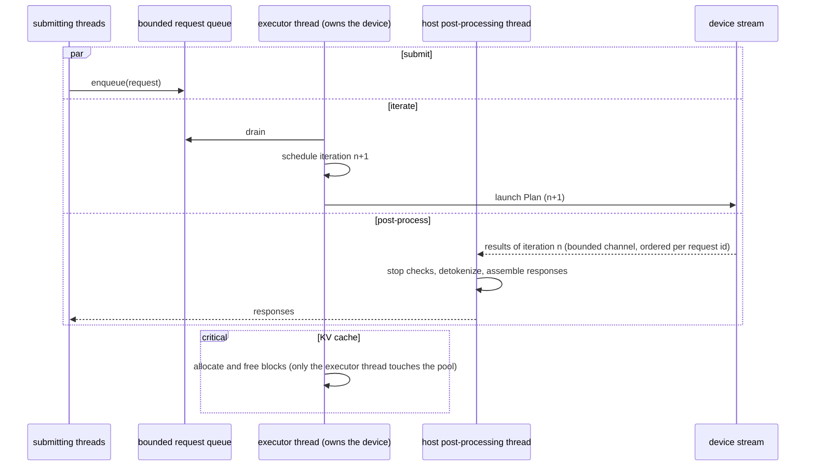

Rules: device buffers are touched only by the executor thread; the queue and
the result channel are bounded; a failure on the host side marks requests
failed and frees their blocks on the executor thread, never from the host.

Artifact (PR #4, RI-ART-004): the reader owns an immutable byte buffer and
shares it freely (`Artifact: Send + Sync`, no interior mutability). The writer
owns one temporary file named `<out>.tmp-<pid>` in the destination directory,
so two processes building the same destination never share a temporary file
and the last `rename` wins atomically. Inside one process the temporary name
is shared, so the writer keeps the set of destinations being written in one
named lock (`writer::IN_FLIGHT`, a `Mutex<BTreeSet<PathBuf>>`, held only to
insert or remove a path, never across I/O); a second concurrent writer of the
same destination is refused as `Error::Busy` instead of corrupting the file.

### Target abstraction and the CPU reference device (RI-TGT-002, RI-TGT-005, RI-RT-008, RI-RT-010, RI-CON-002) — R1

Streams order work on a device; events order work between streams without the
host; host synchronisation is explicit (`synchronize`, `synchronize_event`) or
implicit in a readback (`copy_to_host`). Every one of those is counted by the
device (`SyncCounters`) so a test can assert the decode path performs none
(RI-RT-010). A launch marked `HostSync::Required` ends a graph segment
(RI-GC-015, RI-TGT-005): `capture` splits a sub-plan at those marks and
`replay` runs the segments in order, eagerly on the CPU.

The CPU device is single-stream in R1: every stream id maps to the host thread,
a launch completes before `launch` returns, and `synchronize` is a counted
no-op. Shared mutable state and its primitives:

| State | Primitive | Rule |
|---|---|---|
| `CpuDevice::memory` (buffers, streams, events, bytes in use) | `std::sync::Mutex<Memory>` | held only to allocate, free, copy, create ids, and to check buffers out of and back into the map around a launch; never held while an operator runs, never across another lock (there is no other lock) |
| `CpuDevice::counters` | `std::sync::atomic::AtomicU64` ×3 | incremented with `Relaxed`; read with `Relaxed`; no ordering is required of a counter |
| buffers during a launch | checked out of the map (`BufferBusy` to any other caller) | the launch owns the bytes until it checks them back in, on success and on error (a guard restores them) |

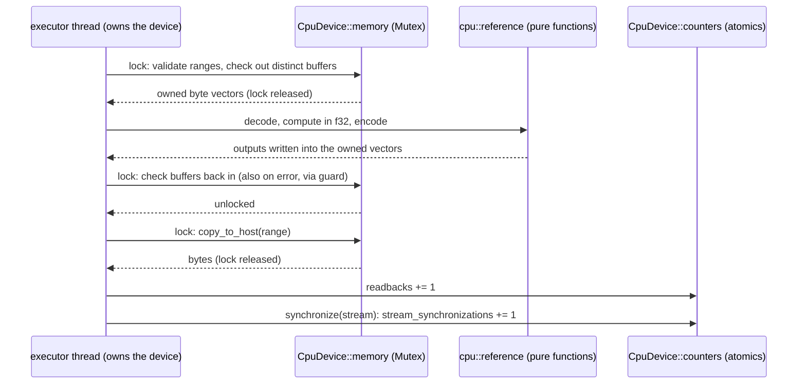

Rules: a device backend (ROCm, #12) keeps the same contract — no lock held
across an enqueue, one stream per iteration (RI-RT-008), device buffers touched
only by the executor thread (RI-CON-002). The target crate never spawns a
thread and never blocks on anything but its own mutex.

