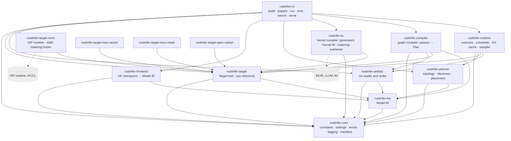
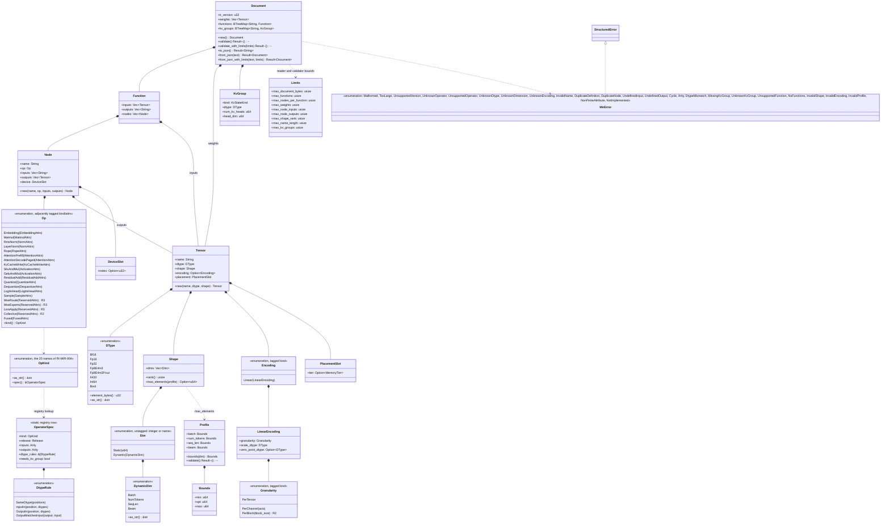
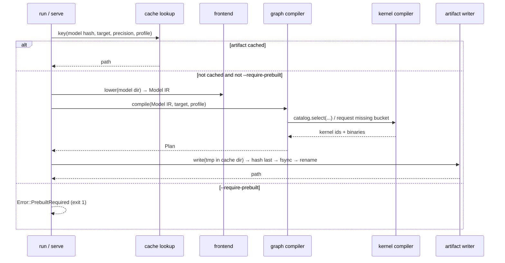
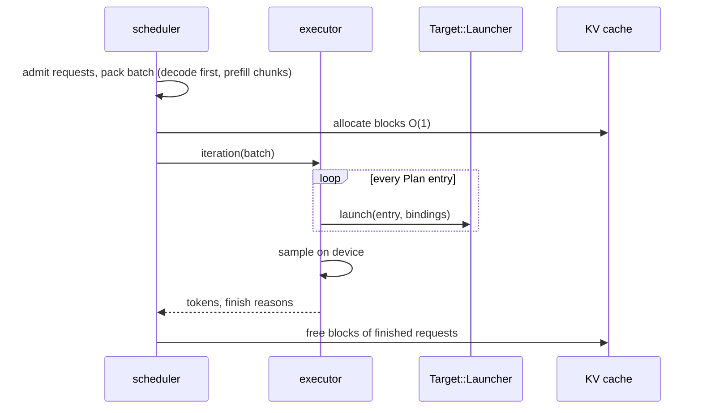
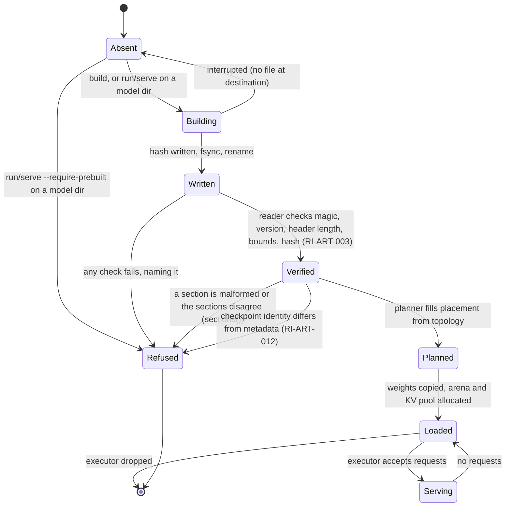
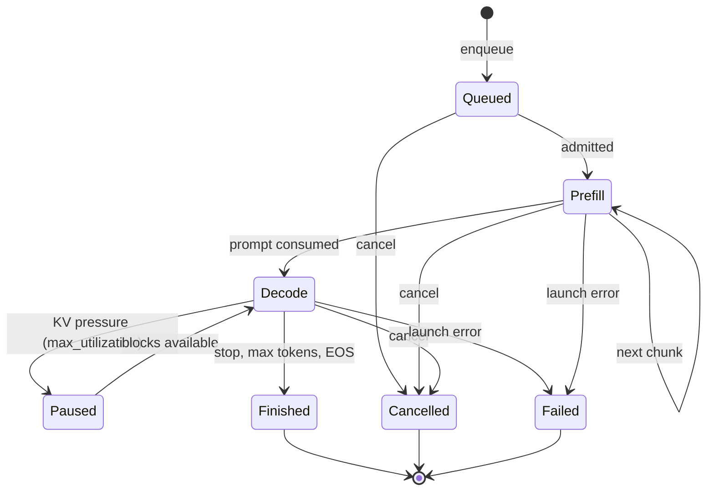
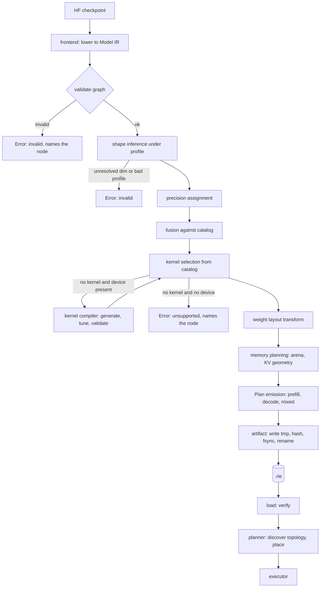
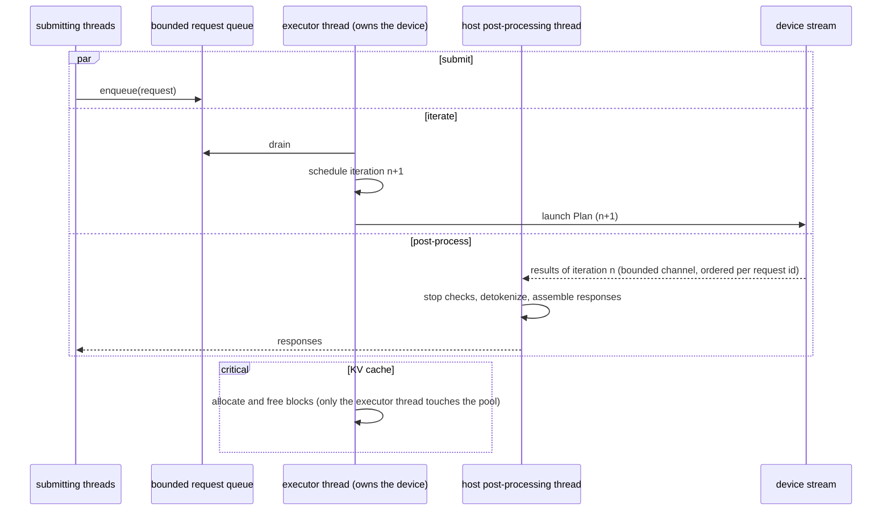

<!-- Generated by scripts/reference/gen_diagrams.py from the rustinfer checkout; do not edit by hand. Regenerate with `.venv/bin/python scripts/reference/gen_diagrams.py`. -->
# Design diagrams

Copied from `docs/uml/*.md` at commit 678b084 2026-11-12. SWG-001 §17.3 requires each
diagram file to carry a header naming the date, author and pull request of its
last update, and the tree's CI checks that header (`scripts/ci/check_doc_freshness.py`)
and that every Mermaid block parses (`scripts/ci/validate_mermaid.py`). The
headers are reproduced below each title. Items the diagrams mark *planned* have
no code behind them yet; the [design](design.html) page says which do.

## Component Diagram

*component diagram, last updated 2026-11-12 by @itej89 in PR #4.*

Each box is one crate under `crates/`; the source tree mirrors this diagram
(SWG-001 §5.9.3). Arrows are Cargo dependencies and point downward only.



`rustinfer-core`, `rustinfer-cli`, `rustinfer-mir` and `rustinfer-artifact`
carry behaviour; every other crate has its error type and public surface so the
dependency graph is fixed from the first commit (G22: logical dependencies made
physical). `rustinfer-mir` depends on `serde` and `serde_json` for the
canonical JSON form; `rustinfer-artifact` on the same plus `sha2` for the
content hash (external, not drawn).

## Class Diagram

*class diagram, last updated 2026-11-12 by @itej89 in PR #4.*

The R1 types with behaviour, plus the R1 shape of the interfaces the SRS fixes
(ADR-003, ADR-005). Items marked *planned* have no code yet.


### Model IR (`rustinfer-mir`, SRS §3.2.3, PR #3)

The typed SSA graph every frontend lowers to and every backend consumes. Data
types are plain structs with public fields and derive `Serialize`/`Deserialize`;
behaviour lives in `Document` (validation, canonical JSON), the operator registry
(a static table, one row per operator) and the bounded reader. Every type is
`Send + Sync` by construction (no interior mutability).



Validation order (RI-MIR-006), first failure wins and names the function, node
and field: version → function names → profile-independent shape and name checks
→ duplicate definitions across weights, inputs and node outputs → undefined
inputs → cycle (Kahn) and definition-before-use order → operator release, arity
and dtype rules from the registry → KV group presence → encoding consistency →
function outputs defined.

### Engine artifact (`rustinfer-artifact`, SRS §3.2.7, ADR-002, PR #4)

The `.rie` file: a fixed header, a section table and nine sections. `Sections`
is the typed content (what a build produces and a load consumes); `Writer`
turns it into bytes atomically; `Artifact` is the verifying reader, which
exposes a section only after magic, version, header length, every bound and
the hash have passed (RI-ART-003, RI-SEC-002). The `weights` section is a
manifest: the artifact holds no weight byte (RI-ART-012). Every type is
`Send + Sync`; the reader is read-only and the writer owns its temporary file.


Reader check order (RI-ART-003, RI-SEC-002), first failure wins and names the
check: file size bound → fixed header present → magic → version in the accepted
set → section count bound → header length → target and producer ASCII → table
(known names in the fixed order, each entry inside the file, aligned, reserved
field zero, no overlap) → SHA-256 of every byte after the header → sections
exposed. Typed sections are parsed on demand with `deny_unknown_fields`;
`sections()` parses all of them and cross-checks: one Plan per Model IR
function naming existing nodes and kernels, manifest keys equal to the Model IR
weight names, every manifest file in the checkpoint identity with its byte range
inside the recorded size, every catalog kernel present, every kernel with a
non-empty binary and Kernel IR (RI-ART-013).

Kernels section layout: `u64 LE index length`, the canonical JSON index
(`{"entries":{"<id>":{"target":…,"binary":[offset,length],"kernel_ir":[offset,length]}}}`,
offsets relative to the end of the index), then the concatenated blobs. Every
range is bounded by the section before it is sliced.

## Sequence Diagrams

*sequence diagram, last updated 2026-11-12 by @itej89 in PR #4.*

### 1. Command start (RI-CLI-010, RI-CLI-011) — implemented in R1

```mermaid
sequenceDiagram
    participant U as User
    participant M as main
    participant C as cli::Cli
    participant S as core::Settings
    participant L as core::logging
    participant V as core::manifest
    participant D as commands::dispatch
    U->>M: rustinfer <subcommand> args
    M->>C: parse_args()
    C-->>M: Command (or exit 0 for --help/--version, exit 2 on usage)
    M->>S: from_env()
    S-->>M: Settings (or SettingsError → exit 1)
    M->>L: configure(level)
    M->>V: log_version_manifest(name, version)
    V-->>U: stderr: ts=… level=info component=manifest startup="version_manifest" …
    M->>D: dispatch(command, settings)
    D->>D: validate paths (RI-CLI-012)
    D-->>M: Ok | Error
    M-->>U: stderr: error=<code> component=<name> detail="…" ; exit 1
```

### 2. Build on first load (RI-CLI-003, RI-ART-004) — R1 design, implemented with the artifact



### 3. One decode iteration (RI-RT-002) — R2



### 4. Model IR document in and out (RI-MIR-006, RI-MIR-007, RI-MIR-008) — implemented in R1

The JSON reader is an external boundary (SWG-001 §8.7): the text is bounded,
parsed into an untyped tree, scanned for version, counts and names, and only
then turned into the typed graph and validated. Every refusal is one `mir`
error with a code, logged as `key=value` at `error`.

```mermaid
sequenceDiagram
    participant C as caller (frontend, artifact reader)
    participant D as mir::Document
    participant S as mir::json::scan
    participant J as serde_json
    participant V as mir::validate
    participant R as mir::registry
    C->>D: from_json(text)
    D->>S: check len ≤ max_document_bytes
    S-->>D: Error::TooLarge (code invalid)
    D->>J: from_str::<Value>(text) (depth bounded by serde_json)
    J-->>D: Error::Malformed (code invalid), logged stage=read boundary=model_ir_json
    D->>S: ir_version in supported set
    S-->>D: Error::UnsupportedVersion{version, supported} (code unsupported)
    D->>S: counts ≤ Limits; operator, dtype, dimension, encoding names; kv_group present
    S-->>D: Error naming node or tensor and field (code invalid)
    D->>J: from_value::<Document>(value)
    J-->>D: Error::Malformed (missing field, wrong type, unknown field)
    D->>V: validate_with_limits(document, limits)
    V->>R: spec(op): release, arity, dtype rules
    V-->>D: first failure naming function, node, field
    D-->>C: Document (typed, immutable by convention) or Error
    C->>D: to_json()
    D->>V: validate()
    D->>J: to_value (BTreeMap keys) then to_string (compact)
    D-->>C: canonical text: sorted keys, exact integers, shortest round-trip reals
```

### 5. Artifact write (RI-ART-004, RI-NFR-007) — implemented in R1

The writer validates the typed sections first (nothing is created for an
invalid build), streams to a temporary file in the destination directory,
writes the hash last, `fsync`s, and renames. Any failure removes the temporary
file; the destination is never half-written.

```mermaid
sequenceDiagram
    participant B as build / first load
    participant W as artifact::Writer
    participant S as artifact::Sections
    participant E as artifact::encode
    participant F as <out>.tmp-<pid>
    participant H as sha2::Sha256
    B->>W: write(sections, out)
    W->>S: validate(target)
    S-->>W: Error naming section, item and field (nothing created)
    W->>E: encode sections → bytes, table, header (hash zero)
    W->>F: create_new in out's directory
    W->>F: write header, sections and alignment padding
    W->>H: hash every byte after the header
    W->>F: seek to offset 72, write the hash
    W->>F: sync_all
    W->>F: rename to out
    F-->>B: Error::Io{op, path}, temporary file removed
    W-->>B: Sha256 of the content; log stage=write status=done bytes=… hash=…
```

### 6. Artifact read and verify (RI-ART-003, RI-SEC-002, RI-ART-012) — implemented in R1

The artifact file is an external boundary (SWG-001 §8.7): every length is
bounded by the file size, no allocation is sized by an untrusted field before
its bound check, and no section is exposed before the hash passes. Each refusal
is one `artifact` error naming the failed check, logged once at `error` as
`stage=read boundary=artifact_file reason=…`.

```mermaid
sequenceDiagram
    participant C as inspect / run
    participant A as artifact::Artifact
    participant D as artifact::decode
    participant H as sha2::Sha256
    participant M as mir::Document
    participant S as artifact::Sections
    C->>A: read(path)
    A->>A: file size ≤ max_file_bytes (before reading)
    A->>D: magic, version ∈ accepted, section_count ≤ max, header_length = 112 + 40·count ≤ size
    D-->>A: Error::BadMagic | UnsupportedVersion | TooLarge | BadHeaderLength
    A->>D: target and producer: NUL-padded printable ASCII
    A->>D: table: known names in order, offset ≥ header_length, offset + length ≤ size (checked), aligned, reserved zero, no overlap
    D-->>A: Error::UnknownSection | SectionOrder | SectionOutOfFile | SectionsOverlap | BadSectionEntry
    A->>H: sha256(bytes[header_length..]) == header.hash
    H-->>A: Error::HashMismatch{expected, found}
    A-->>C: Artifact (sections addressable, nothing parsed yet)
    C->>A: plan() / profile() / metadata() / catalog() / kernels() / weights()
    A->>D: bounded canonical JSON, deny_unknown_fields; kernels index ranges inside the section
    D-->>A: Error::MalformedSection{section, detail} | InvalidKernel
    C->>A: model_ir()
    A->>M: Document::from_json(section) (its own bounds, RI-MIR-008)
    C->>A: sections()
    A->>S: validate(header.target): cross-references of plan, kernels, catalog, manifest and identity
    S-->>C: Error::Inconsistent{section, item, reason}
    C->>S: metadata.checkpoint.verify(observed identity)
    S-->>C: Error::CheckpointMismatch{file, reason} naming the first differing file
```

## State Diagrams

*state diagram, last updated 2026-11-12 by @itej89 in PR #4.*

### Artifact lifecycle (RI-ART, RI-CLI-003, RI-CLI-004)



### Request lifecycle (RI-RT, RI-SCH) — R2



## Activity Diagram: the build pipeline

*activity diagram, last updated 2026-11-10 by @itej89 in PR #2.*

The graph compiler's pass order (RI-GC-001 to RI-GC-008) and where the kernel
compiler and planner enter.



## Concurrency Diagram

*concurrency diagram, last updated 2026-11-12 by @itej89 in PR #4.*

R1 has one thread: the command runs sequentially (RI-CON-001). The diagram
records the R2 design so the R1 types are shaped for it (RI-CON-002, RI-CON-003).



Rules: device buffers are touched only by the executor thread; the queue and
the result channel are bounded; a failure on the host side marks requests
failed and frees their blocks on the executor thread, never from the host.

Artifact (PR #4, RI-ART-004): the reader owns an immutable byte buffer and
shares it freely (`Artifact: Send + Sync`, no interior mutability). The writer
owns one temporary file named `<out>.tmp-<pid>` in the destination directory,
so two processes building the same destination never share a temporary file
and the last `rename` wins atomically. Inside one process the temporary name
is shared, so the writer keeps the set of destinations being written in one
named lock (`writer::IN_FLIGHT`, a `Mutex<BTreeSet<PathBuf>>`, held only to
insert or remove a path, never across I/O); a second concurrent writer of the
same destination is refused as `Error::Busy` instead of corrupting the file.

