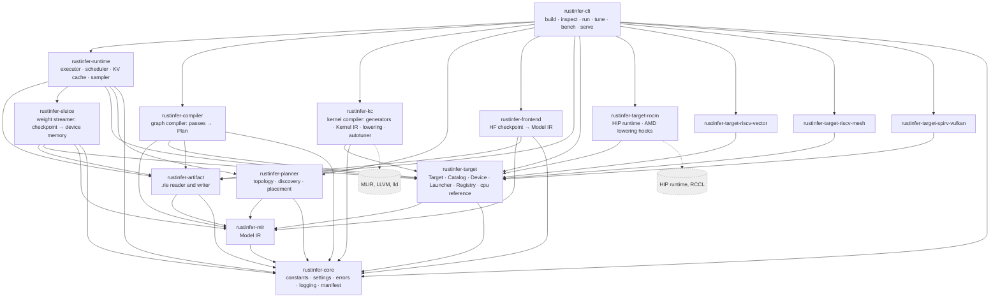
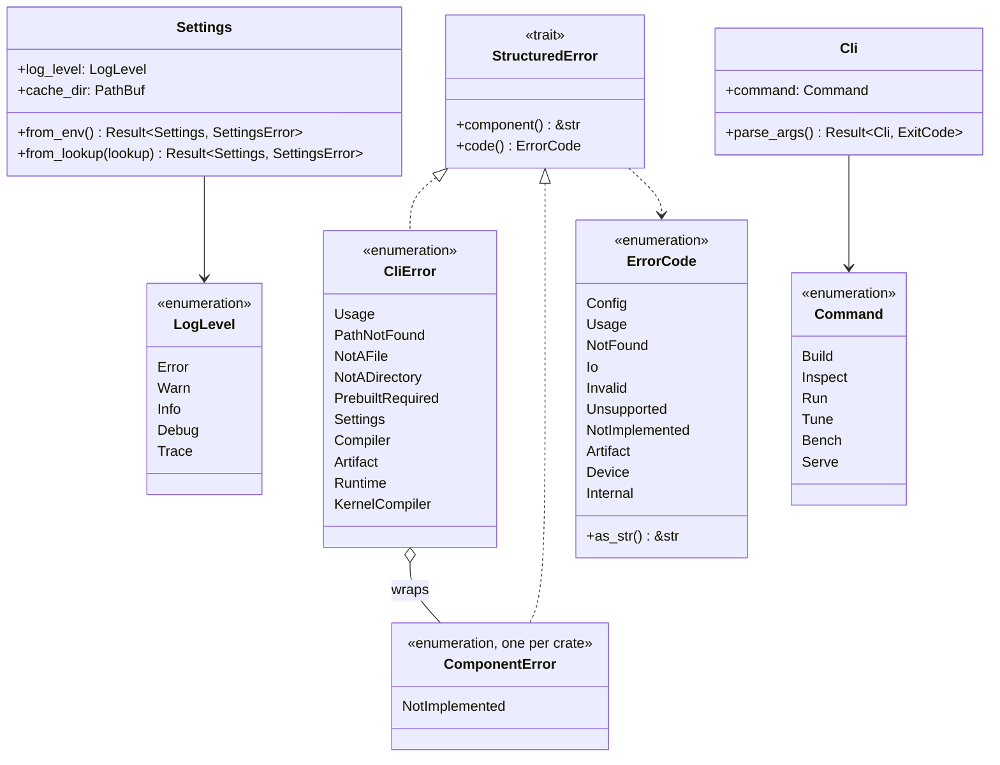
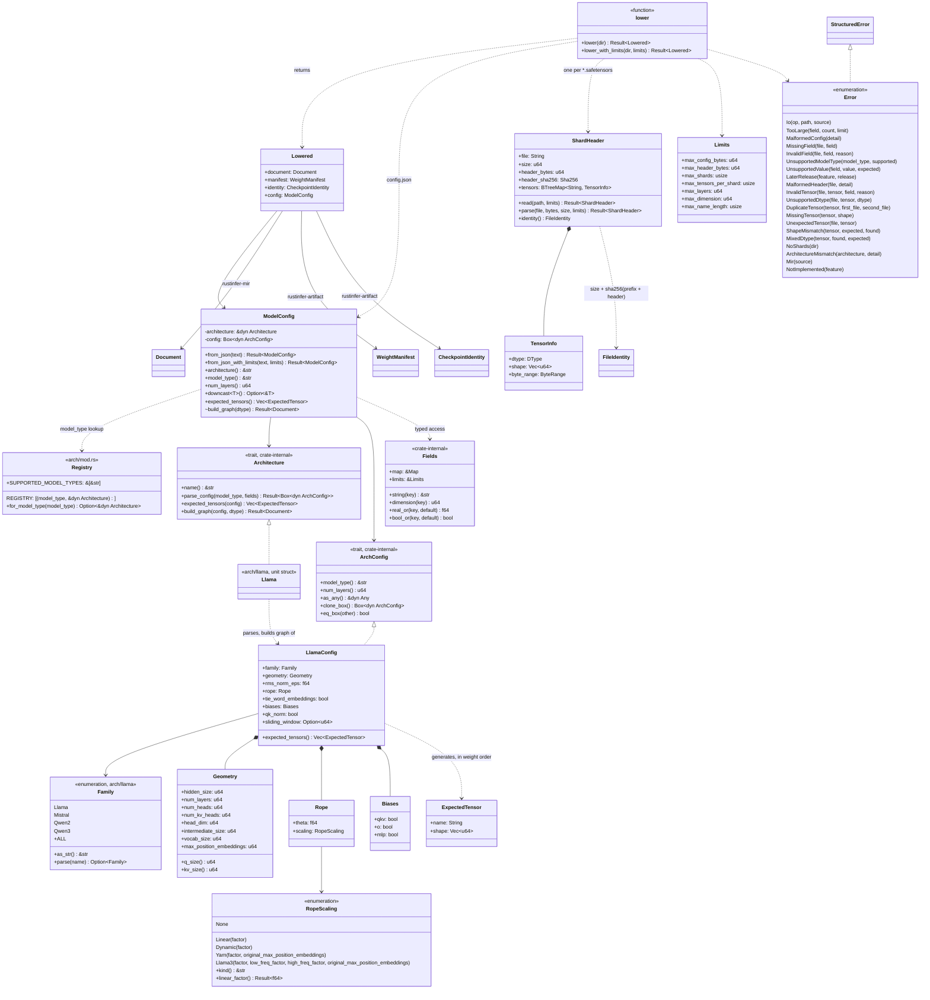
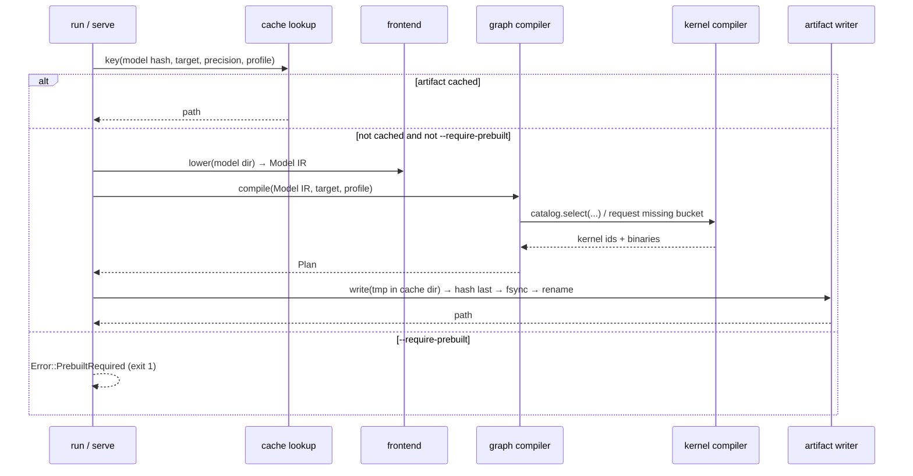
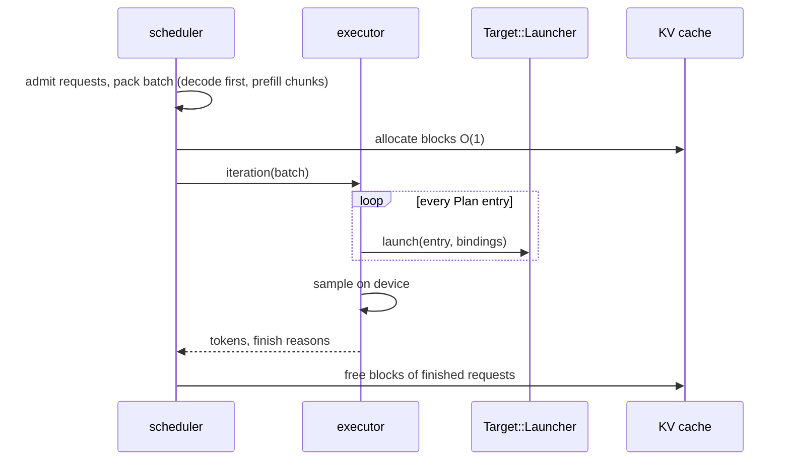
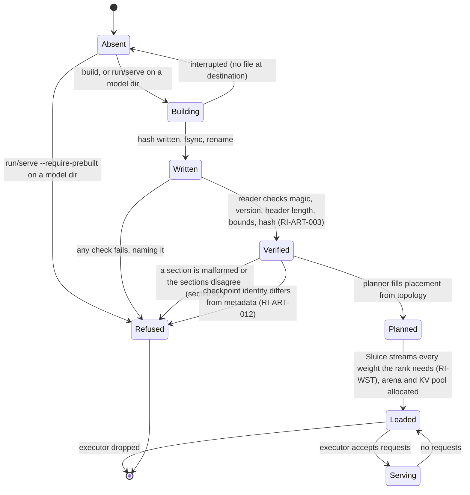
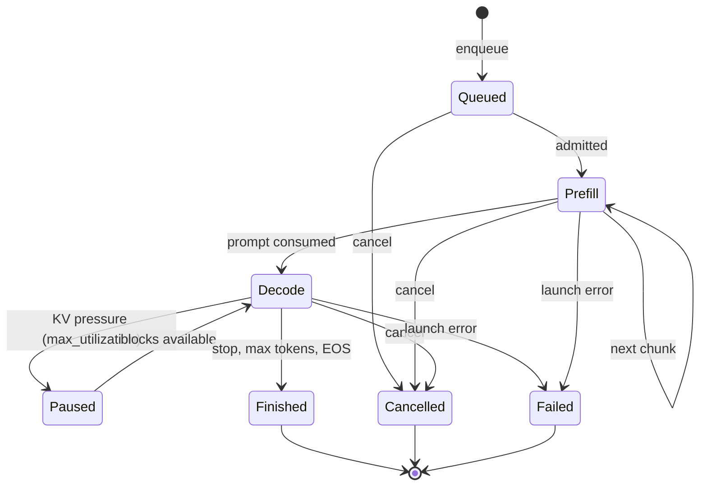
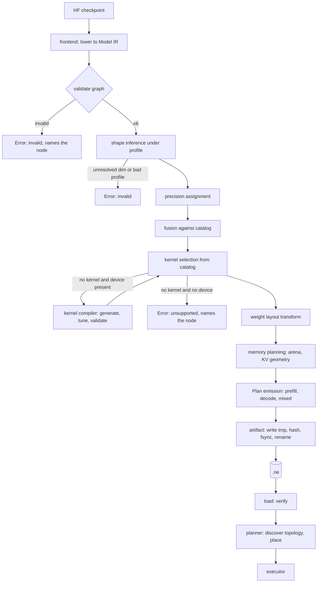

<!-- Generated by scripts/reference/gen_diagrams.py from the rustinfer checkout; do not edit by hand. Regenerate with `.venv/bin/python scripts/reference/gen_diagrams.py`. -->
# Design diagrams

Copied from `docs/uml/*.md` at commit 7913427 2026-11-12. SWG-001 §17.3 requires each
diagram file to carry a header naming the date, author and pull request of its
last update, and the tree's CI checks that header (`scripts/ci/check_doc_freshness.py`)
and that every Mermaid block parses (`scripts/ci/validate_mermaid.py`). The
headers are reproduced below each title. Items the diagrams mark *planned* have
no code behind them yet; the [design](design.html) page says which do.

## Component Diagram

*component diagram, last updated 2026-11-12 by @itej89 in PR #7.*

Each box is one crate under `crates/`; the source tree mirrors this diagram
(SWG-001 §5.9.3). Arrows are Cargo dependencies and point downward only.



`rustinfer-core`, `rustinfer-cli`, `rustinfer-mir`, `rustinfer-artifact`,
`rustinfer-planner`, `rustinfer-target` and `rustinfer-sluice` carry behaviour; every other crate has
its error type and public surface so the dependency graph is fixed from the
first commit (G22: logical dependencies made physical). `rustinfer-mir` depends
on `serde` and `serde_json` for the canonical JSON form; `rustinfer-artifact` on
the same plus `sha2` for the content hash (external, not drawn).
`rustinfer-planner` carries behaviour from PR #15 (topology model, placement
types, single-device planner) and depends on `rustinfer-mir` for the document
it fills and on `serde` and `serde_json` for the `topology` and `placement`
sections; it depends on no target or artifact crate.

`rustinfer-kc` carries behaviour from PR #7 (the Kernel IR dialect, the typed
builder, the MLIR link) and depends on `tracing`; with its `mlir` feature it
links MLIR and LLVM 23 statically through `melior` and `mlir-sys` (ADR-007),
the external node drawn dashed above; `lld` joins with #8.

The command is the composition root of the target registry (ADR-003,
RI-TGT-004): it depends on every backend crate and registers each crate's one
`TargetEntry`; the compiler, planner and runtime see only `rustinfer-target`.
The four backend crates implement `Target` with an empty catalog and no device
until their hardware issues land (#12 and the RISC-V milestones).

`rustinfer-sluice` (PR #18) is the weight streamer of SRS §3.2.22: it depends on
`rustinfer-artifact` for the weight manifest and the checkpoint identity, on
`rustinfer-target` for the `Device` it fills, on `rustinfer-mir` for `DType`,
and on `serde_json` and `sha2` (already in the workspace) for the safetensors
header and the hashes; it never sees the Model IR document or the Plan. The
runtime (#13) and the `run` command (#14) are its callers; the edge from the
runtime is drawn for them and no crate links it yet. The checkpoint files it
reads are its external boundary (SWG-001 §8.7, `docs/entry-points.md`).

## Class Diagram

*class diagram, last updated 2026-11-12 by @itej89 in PR #7.*

The R1 types with behaviour of the scaffold and the command.



The `Target` trait family is drawn in its own section below (PR #5).

### Model IR (`rustinfer-mir`, SRS §3.2.3, PR #3)

The typed SSA graph every frontend lowers to and every backend consumes. Data
types are plain structs with public fields and derive `Serialize`/`Deserialize`;
behaviour lives in `Document` (validation, canonical JSON), the operator registry
(a static table, one row per operator) and the bounded reader. Every type is
`Send + Sync` by construction (no interior mutability).


Validation order (RI-MIR-006), first failure wins and names the function, node
and field: version → function names → profile-independent shape and name checks
→ duplicate definitions across weights, inputs and node outputs → undefined
inputs → cycle (Kahn) and definition-before-use order → operator release, arity
and dtype rules from the registry → KV group presence → encoding consistency →
function outputs defined.

### Engine artifact (`rustinfer-artifact`, SRS §3.2.7, ADR-002, PR #4)

The `.rie` file: a fixed header, a section table and nine sections. `Sections`
is the typed content (what a build produces and a load consumes); `Writer`
turns it into bytes atomically; `Artifact` is the verifying reader, which
exposes a section only after magic, version, header length, every bound and
the hash have passed (RI-ART-003, RI-SEC-002). The `weights` section is a
manifest: the artifact holds no weight byte (RI-ART-012). Every type is
`Send + Sync`; the reader is read-only and the writer owns its temporary file.


Reader check order (RI-ART-003, RI-SEC-002), first failure wins and names the
check: file size bound → fixed header present → magic → version in the accepted
set → section count bound → header length → target and producer ASCII → table
(known names in the fixed order, each entry inside the file, aligned, reserved
field zero, no overlap) → SHA-256 of every byte after the header → sections
exposed. Typed sections are parsed on demand with `deny_unknown_fields`;
`sections()` parses all of them and cross-checks: one Plan per Model IR
function naming existing nodes and kernels, manifest keys equal to the Model IR
weight names, every manifest file in the checkpoint identity with its byte range
inside the recorded size, every catalog kernel present, every kernel with a
non-empty binary and Kernel IR (RI-ART-013).

Kernels section layout: `u64 LE index length`, the canonical JSON index
(`{"entries":{"<id>":{"target":…,"binary":[offset,length],"kernel_ir":[offset,length]}}}`,
offsets relative to the end of the index), then the concatenated blobs. Every
range is bounded by the section before it is sliced.
### Topology planner (`rustinfer-planner`, SRS §3.2.6, PR #15)

The R1 surface: the topology model of RI-PLN-001 (devices, memory tiers,
links, offload engines; JSON in and out under its own version), the
`Placement` that fills the Model IR's placement and device slots (RI-MIR-005)
and serialises to the artifact's `placement` section (RI-PLN-005), the
`Planner` trait every placement strategy implements, and the single-device
planner. Discovery (RI-PLN-002) and the cost-model planner (RI-PLN-003,
RI-PLN-006) are reserved interface points that return `not_implemented`.
Indices (`local_tier`, `endpoints`, `device`) point into the topology's own
lists; a placement's device indices point into the topology's device list.
Every type is `Send + Sync` (no interior mutability).


`place(document, profile, topology, planner)` is the one call the rest of R1
makes: it validates the three inputs, asks the planner for a `Placement`,
applies it to the document and checks that no slot is left empty. The
single-device planner puts every tensor in the selected device's local tier and
every node on that device, and refuses with `capacity_exceeded` when the
document's footprint at the profile's `max` (weights plus the largest
function's inputs and outputs, element count times element size) exceeds the
tier's capacity. `discover()` (RI-PLN-002) returns `not_implemented` in R1.

### Target abstraction (`rustinfer-target`, SRS §3.2.8, ADR-003, PR #5)

One trait, `Target`, composed of three object-safe capabilities. `Catalog` is
device-free (the graph compiler holds `&dyn Catalog`); `Device` owns memory,
streams, events, copies and graph segments; `Launcher` executes one resolved
launch. A backend crate implements all three and exposes one `TargetEntry`; the
command's composition root registers every entry in a `Registry` keyed by
architecture string only (RI-TGT-001). The CPU reference target lives in this
crate (`cpu` module); the four device backends are stubs with an `EmptyCatalog`
and no device (RI-RV-001).

```mermaid
classDiagram
    class Registry {
        +new() Registry
        +register(entry: TargetEntry) Result~()~
        +architectures() Vec~&str~
        +contains(architecture) bool
        +resolve(architecture) Result~Box~dyn Target~~
    }
    class TargetEntry {
        +architectures: &[&str]
        +build: fn(&str) Result~Box~dyn Target~~
    }
    class Target {
        <<trait: Send + Sync>>
        +architecture() &str
        +catalog() &dyn Catalog
        +devices() Vec~DeviceProperties~
        +device(index) Result~&dyn Device~
        +launcher(index) Result~&dyn Launcher~
    }
    class Catalog {
        <<trait: Send + Sync>>
        +architecture() &str
        +entries() &[KernelEntry]
        +select(query: &KernelQuery) Result~&KernelEntry~
    }
    class Device {
        <<trait: Send + Sync>>
        +properties() &DeviceProperties
        +alloc(bytes) Result~Buffer~
        +free(buffer: BufferId) Result~()~
        +create_stream() Result~StreamId~
        +create_event() Result~EventId~
        +record(event, stream) Result~()~
        +wait(stream, event) Result~()~
        +copy_to_device(dst: BufferRange, src: &[u8], stream) Result~()~
        +copy_to_host(src: BufferRange, dst: &mut [u8], stream) Result~()~
        +copy_on_device(dst, src, stream) Result~()~
        +synchronize(stream) Result~()~
        +synchronize_event(event) Result~()~
        +capture(stream, bucket, launches: &[Launch]) Result~Graph~
        +replay(graph: &Graph, stream) Result~()~
        +sync_counters() SyncCounters
        +reset_sync_counters()
    }
    class Launcher {
        <<trait: Send + Sync>>
        +load(binary: &KernelBinary) Result~()~
        +launch(launch: &Launch, stream) Result~()~
    }
    class KernelEntry {
        +id: KernelId
        +op: OpKind
        +dtypes: Vec~DType~
        +layout: Layout
        +shape_rules: Vec~ShapeRule~
        +cost: KernelCost
        +validation: Option~Validation~
        +parameters: BTreeMap~String, u64~
        +matches(query, architecture) bool
    }
    class KernelQuery {
        +op: OpKind
        +dtype: DType
        +layout: Layout
        +bucket: Bucket
    }
    class KernelCost {
        <<enumeration>>
        Untuned
        Measured(microseconds)
    }
    class ShapeRule {
        <<enumeration>>
        MultipleOf(dim, of)
        AtLeast(dim, min)
        AtMost(dim, max)
        +holds(bucket) bool
    }
    class Validation {
        +architecture: String
        +driver_version: String
        +date: String
    }
    class KernelBinary {
        +id: KernelId
        +architecture: String
        +format: BinaryFormat
        +bytes: Vec~u8~
        +kernel_ir: Option~String~
    }
    class BinaryFormat {
        <<enumeration>>
        Native
        HsaCodeObject
        SpirV
        RiscvElf
    }
    class EmptyCatalog {
        +new(architecture) EmptyCatalog
    }
    class DeviceProperties {
        +architecture: String
        +name: String
        +index: u32
        +memory_bytes: u64
        +compute_units: u32
    }
    class Buffer {
        +id: BufferId
        +bytes: u64
        +range() BufferRange
        +slice(offset, len) Result~BufferRange~
    }
    class BufferRange {
        +buffer: BufferId
        +offset: u64
        +len: u64
    }
    class Arena {
        +new(device, bytes) Result~Arena~
        +buffer() &Buffer
        +region(offset, len) Result~BufferRange~
        +release(device) Result~()~
    }
    class SyncCounters {
        +stream_synchronizations: u64
        +event_synchronizations: u64
        +readbacks: u64
        +total() u64
    }
    class Launch {
        +kernel: KernelId
        +op: Op
        +inputs: Vec~Operand~
        +outputs: Vec~Operand~
        +host_sync: HostSync
    }
    class Operand {
        +range: BufferRange
        +dtype: DType
        +shape: Vec~u64~
        +elements() u64
    }
    class HostSync {
        <<enumeration>>
        No
        Required
    }
    class Bucket {
        +batch: u64
        +num_tokens: u64
    }
    class Graph {
        +bucket: Bucket
        +segments: Vec~Segment~
    }
    class Segment {
        +launches: Vec~Launch~
        +host_sync_after: bool
    }
    class CpuTarget {
        +new() CpuTarget
        +with_memory_limit(bytes) CpuTarget
        +entry() TargetEntry
    }
    class CpuCatalog {
        <<one entry per R1 compute operator, cpu.&lt;op&gt;>>
    }
    class CpuDevice {
        -memory: Mutex~Memory~
        -counters: atomics
    }
    class reference {
        <<module: fp32 oracle functions>>
        +embedding() +matmul() +rmsnorm() +layernorm() +rope()
        +attention_prefill() +attention_decode_paged() +kv_cache_write()
        +silu_and_mul() +gelu_and_mul() +residual_add() +quantize()
        +dequantize() +logits_head() +sample()
    }
    class numeric {
        <<module: element conversions, round to nearest even>>
        +bf16 +fp16 +fp8_e4m3 +fp8_e4m3fnuz
    }
    class TargetError {
        <<enumeration: CatalogEmpty, NoKernel, UnknownArchitecture, InvalidArchitecture, DuplicateArchitecture, NoDevice, OutOfMemory, InvalidAllocation, UnknownBuffer, OutOfBounds, BufferBusy, UnknownStream, UnknownEvent, UnknownKernel, UnsupportedBinary, OperandMismatch, UnsupportedDtype, IndexOutOfRange, NotImplemented>>
    }
    Registry o-- TargetEntry
    TargetEntry ..> Target : builds
    Target *-- Catalog
    Target *-- Device
    Target *-- Launcher
    Catalog o-- KernelEntry
    Catalog ..> KernelQuery
    KernelEntry *-- KernelCost
    KernelEntry *-- ShapeRule
    KernelEntry *-- Validation
    KernelBinary *-- BinaryFormat
    Catalog <|.. EmptyCatalog
    Catalog <|.. CpuCatalog
    Device <|.. CpuDevice
    Launcher <|.. CpuTarget
    Target <|.. CpuTarget
    CpuTarget *-- CpuCatalog
    CpuTarget *-- CpuDevice
    CpuTarget ..> reference : launch decodes, calls, encodes
    CpuTarget ..> numeric
    Device ..> DeviceProperties
    Device ..> Buffer
    Buffer ..> BufferRange
    Arena *-- Buffer
    Device ..> SyncCounters
    Launcher ..> Launch
    Launcher ..> KernelBinary
    Launch *-- Operand
    Launch *-- HostSync
    Operand *-- BufferRange
    Graph *-- Segment
    Graph *-- Bucket
    Segment *-- Launch
    KernelQuery *-- Bucket
    StructuredError <|.. TargetError
```



Operand conventions of the CPU launcher (also the convention a Plan resolves
to): `inputs` in the order RI-MIR-004 lists them, then for `kv_cache_write`
and `attention_decode_paged` the key and value pools
(`[num_blocks, block_size, num_kv_heads, head_dim]`); `outputs` in the
operator's order, `kv_cache_write` writing the two pools as its outputs and
`quantize` always producing `quantized, scale`. Every float operand is decoded
to `f32`, every integer operand to `i64`, the operator runs in `f32`, and the
result is encoded into the output dtype with round-to-nearest-even
(RI-TGT-003). `fused` has no CPU kernel: its reference value is its parts run
in order, so the compiler never fuses for `cpu` (RI-GC-003).

### Sluice, the weight streamer (`rustinfer-sluice`, SRS §3.2.22, PR #18)

Sluice's only description of the model is the weight manifest (RI-ART-005); it
never sees the Model IR or the Plan. `Sluice::open` canonicalises the
checkpoint root, observes the checkpoint identity (`config.json` hash, every
recorded shard's size and header hash) and refuses on the first difference
(RI-ART-012), parses the safetensors header of every shard the rank needs
under named bounds (RI-SEC-003), and checks dtype, shape and byte range of
every needed tensor against that header before any tensor byte is read
(RI-WST-005). `Sluice::load` then streams each needed weight by byte range
through a staging pool bounded by `RUSTINFER_STAGING_BYTES` (RI-WST-002),
copies it to the device and runs the manifest's transform on the device as
runs of `copy_on_device` (RI-WST-003; the graph compiler's recorded launches
replace the runs from #10), with reads, copies and transforms on three
threads joined by bounded channels (RI-WST-004). `verify_weights` is the
separate full read that `--verify-weights` asks for.

```mermaid
classDiagram
    class Sluice {
        -root: PathBuf
        -rank: u32
        -config: SluiceConfig
        -plans: Vec~WeightPlan~
        +open(manifest: &WeightManifest, identity: &CheckpointIdentity, root: &Path, rank, config) Result~Sluice~
        +rank() u32
        +weights() impl Iterator~&str~
        +needed_bytes() u64
        +load(device: &dyn Device) Result~LoadedWeights~
        +digest_weights() Result~WeightDigests~
        +verify_weights(expected: &WeightDigests) Result~()~
    }
    class SluiceConfig {
        +staging_bytes: u64
        +from_settings(settings: &Settings) SluiceConfig
        +with_staging_bytes(bytes) Result~SluiceConfig~
        +chunk_bytes() u64
        +chunks() u64
    }
    class WeightPlan {
        <<crate-private: one needed weight, verified against its shard header>>
        +name: String
        +file: PathBuf
        +tensor: String
        +dtype: DType
        +source_shape: Vec~u64~
        +target_shape: Vec~u64~
        +target_layout: String
        +transform: Transform
        +offset: u64
        +bytes: u64
        +slices(chunk_bytes) impl Iterator~Slice~
    }
    class Slice {
        <<crate-private: one bounded piece of one tensor>>
        +weight: usize
        +index: usize
        +element_start: u64
        +elements: u64
        +file_offset: u64
        +bytes: u64
        +is_first() bool
        +is_last() bool
    }
    class Transform {
        <<enumeration: Identity, Transpose, Pad(rows, cols)>>
        +parse(text) Result~Transform~
        +as_str() String
        +target_shape(source: &[u64]) Result~Vec~u64~~
        +runs(shape, element_start, element_end) impl Iterator~Run~
        +pad_regions(shape) impl Iterator~Region~
        +apply_host(shape, dtype, source: &[u8]) Result~Vec~u8~~
    }
    class Run {
        +source_element: u64
        +target_element: u64
        +elements: u64
    }
    class ShardHeader {
        <<crate-private: the parsed safetensors header of one file>>
        +read(path, size) Result~ShardHeader~
        +data_start: u64
        +tensors: BTreeMap~String, TensorHeader~
        +prefix_bytes() &[u8]
        +tensor(name) Option~&TensorHeader~
    }
    class TensorHeader {
        +dtype: String
        +shape: Vec~u64~
        +data_offsets: [u64; 2]
        +dtype_parsed() Option~DType~
    }
    class StagingPool {
        <<crate-private: SLUICE_STAGING_CHUNKS chunks of chunk_bytes, accounted>>
        +new(chunk_bytes, chunks) StagingPool
        +take() Chunk
        +give(chunk)
        +peak_bytes() u64
    }
    class Pipeline {
        <<crate-private: reader, copier, transformer threads over bounded channels>>
        +run(sluice, device, destinations) Result~LoadReport~
    }
    class LoadedWeights {
        -weights: BTreeMap~String, LoadedWeight~
        -report: LoadReport
        +get(name) Option~&LoadedWeight~
        +iter() impl Iterator
        +len() usize
        +report() &LoadReport
        +release(self, device: &dyn Device) Result~()~
    }
    class LoadedWeight {
        +buffer: Buffer
        +dtype: DType
        +shape: Vec~u64~
        +layout: String
    }
    class LoadReport {
        +weights: usize
        +slices: u64
        +bytes_read: u64
        +bytes_copied: u64
        +bytes_transformed: u64
        +staging_budget_bytes: u64
        +staging_peak_bytes: u64
        +read_busy: Duration
        +copy_busy: Duration
        +transform_busy: Duration
        +wall: Duration
        +per_weight: BTreeMap~String, WeightReport~
        +serial_sum() Duration
        +overlap_ratio() f64
    }
    class WeightReport {
        +bytes: u64
        +slices: u64
        +transform: String
    }
    class SluiceError {
        <<enumeration: Io, InvalidPath, TooLarge, MalformedHeader, InvalidHeaderField, Identity, FileUnrecorded, TensorMissing, HeaderMismatch, UnsupportedLayout, UnknownTransform, InvalidTransform, InvalidStagingBudget, Device, PipelineClosed, DigestMissing, DigestMismatch>>
    }
    Sluice *-- SluiceConfig
    Sluice *-- WeightPlan
    Sluice ..> WeightManifest : reads
    Sluice ..> CheckpointIdentity : observes and verifies
    Sluice ..> ShardHeader : parses, bounded
    Sluice ..> Pipeline : load
    Sluice ..> Device : alloc, streams, events, copies, free
    Sluice ..> Settings : SluiceConfig::from_settings
    WeightPlan *-- Transform
    WeightPlan ..> Slice
    Transform ..> Run
    ShardHeader *-- TensorHeader
    Pipeline ..> StagingPool
    Pipeline ..> Transform : runs on the device
    Pipeline ..> LoadReport : produces
    LoadedWeights *-- LoadedWeight
    LoadedWeights *-- LoadReport
    LoadReport *-- WeightReport
    LoadedWeight *-- Buffer
    StructuredError <|.. SluiceError
```

Transform strings of the manifest in R1 (`WEIGHT_TRANSFORM_*` constants):
`identity` (any rank), `transpose` (rank 2, `[r, c]` row-major to `[c, r]`
row-major, which is the column-major form of the source) and
`pad:<rows>x<cols>` (rank 2, zero-filled to `[rows, cols]` with
`rows >= r`, `cols >= c`). Any other string is refused naming the weight and
the transform; a `source_layout` other than `row_major` is refused likewise.
The target buffer of a weight holds `target_shape` elements of the source
dtype in row-major order of that shape. `Transform::apply_host` is the host
reference every device result is compared with (RI-WST-003).
### Frontend (`rustinfer-frontend`, SRS §3.2.2, PR #6)

A Hugging Face checkpoint directory lowered into one Model IR document with
`prefill` and `decode` over one weight set, the weight manifest and the
checkpoint identity. Two external boundaries (SWG-001 §8.7): `config.json`
and the safetensors header of every shard, both untrusted, both parsed under
`Limits` into typed structures before anything is derived from them. No
weight byte is read (RI-FE-004). Everything is a pure function of the
directory contents; there is no shared state.

The crate is split at the **architecture seam** (`src/arch/`): the generic
modules (`lowering`, `config`, `fields`, `safetensors`, `mapping`, `limits`,
`error`) mention no model family; everything that varies per architecture
sits behind the crate-internal `Architecture` trait, selected by `model_type`
through the registry of `arch/mod.rs`. The `LLaMA` family (`llama`,
`mistral`, `qwen2`, `qwen3`) is the one architecture of R1, under
`src/arch/llama/`; a minimal test-only architecture proves the seam. Adding
an architecture is one directory plus one registry line (RI-FE-005 is the
first real one).



**Lowering, per layer `i`** (the `LLaMA` architecture's operator sequence of
`prefill` and `decode`; tensor names are `layers.i.<role>`, node names
`layers.i.<op>`): `rmsnorm(h, input_layernorm)` → `matmul` q, k, v
(`transpose_b`, bias when the family has one) → `rmsnorm` q and k by
`q_norm`/`k_norm` (qwen3 only) → `rope(q, k, positions)` →
`kv_cache_write(k_rot, v, slot_mapping)` into the one KV group `main` →
`attention_prefill(q_rot, k_rot, v)` in `prefill` or
`attention_decode_paged(q_rot, block_table, seq_lens)` in `decode` →
`matmul` o → `residual_add` → `rmsnorm(post_attention_layernorm)` →
`matmul` gate and up → `silu_and_mul(gate, up)` → `matmul` down →
`residual_add`. After the last layer: `rmsnorm(model.norm)` →
`logits_head(lm_head.weight`, or `model.embed_tokens.weight` when tied`)` →
`sample`. Function inputs and outputs come from `arch/signature.rs`, the one
calling convention every architecture uses: `token_ids`, `positions`,
`slot_mapping` (and `block_table`, `seq_lens` in `decode`) in; `logits` and
`tokens` out (RI-SMP-003 returns logprobs from the same logits the sample
used). The compute dtype is the embedding table's dtype and every weight
must share it (a mixed checkpoint is refused naming the tensor); logits are
`fp32`. The manifest's `target_layout` and `transform` are the frontend's
defaults (`row_major`, `identity`) that the graph compiler overwrites
(RI-GC-008).

### Kernel IR and the MLIR link (`rustinfer-kc`, SRS §3.2.5, ADR-005, ADR-007, PR #7)

The tile-level Kernel IR is the `kir` MLIR dialect. Its operation set is a Rust
table (`OpSpec`), from which the crate generates the IRDL definition that MLIR
loads at context creation and the verifier it runs on every kernel; the
builder emits the generic textual form MLIR itself prints, so the text a
generator produces (RI-KC-001) is byte-identical to the text MLIR prints after
parsing it (the canonical form kept beside each binary, RI-ART-013). Tiles are
values (`vector<RxCxT>`, the register space); buffers are `memref` values in
the `global` (1) or `shared` (3) memory space; structured control flow is
`scf.for`; scalars are `arith`. No operation of the dialect produces a thread,
lane or block identity (RI-KC-002). `KernelContext` is the only module that
touches MLIR (`crates/rustinfer-kc/src/mlir/`, the `unsafe` module of ADR-007);
it exists only with the `mlir` feature.

```mermaid
classDiagram
    class OpKind {
        <<enumeration>>
        TileLoad
        TileStore
        MakeMask
        Mma
        Reduce
        Barrier
        +name() &str
    }
    class OpSpec {
        +kind: OpKind
        +operands: &[OperandSpec]
        +results: &[ResultSpec]
        +attributes: &[AttributeSpec]
    }
    class OperandSpec {
        +name: &str
        +constraint: Constraint
        +arity: Arity
    }
    class Constraint {
        <<enumeration>>
        AnyMemref
        AnyVector
        Index
    }
    class Arity {
        <<enumeration>>
        Single
        Optional
        Variadic
    }
    class AttributeSpec {
        +name: &str
        +allowed: &[AttributeValue]
    }
    class ElementType {
        <<enumeration>>
        Bf16
        F16
        F32
        F8E4M3Fn
        F8E5M2
        F8E4M3Fnuz
        I32
        I8
        +mlir_name() &str
    }
    class MemorySpace {
        <<enumeration>>
        Global = 1
        Shared = 3
    }
    class Layout {
        <<enumeration>>
        RowMajor
        ColMajor
    }
    class ReduceKind {
        <<enumeration>>
        Sum
        Max
    }
    class TileType {
        +shape: Vec~u64~
        +element: ElementType
        +new(shape, element) Result~TileType~
        +mlir_type() String
    }
    class BufferType {
        +shape: Vec~u64~
        +element: ElementType
        +space: MemorySpace
        +new(shape, element, space) Result~BufferType~
        +mlir_type() String
    }
    class Value {
        <<Copy, opaque handle>>
    }
    class KernelBuilder {
        +new(name, buffers: &[BufferType]) Result~KernelBuilder~
        +arguments() Vec~Value~
        +index(value: u64) Result~Value~
        +tile_load(buffer, indices, tile: TileType, layout, mask: Option) Result~Value~
        +tile_store(tile, buffer, indices, layout, mask: Option) Result~()~
        +make_mask(bounds, shape) Result~Value~
        +mma(a, b, c) Result~Value~
        +reduce(tile, kind, axis) Result~Value~
        +add(lhs, rhs) Result~Value~
        +barrier() Result~()~
        +for_loop(lower, upper, step, body: FnOnce) Result~()~
        +finish() Result~KernelModule~
    }
    class KernelModule {
        +name() &str
        +to_mlir() &str
        +operation_count() usize
    }
    class Flavor {
        <<enumeration>>
        Host
        +pipeline() &[&str]
        +lower_barrier() BarrierLowering
    }
    class BarrierLowering {
        <<enumeration>>
        Erase
        Replace(op name)
    }
    class LinkStatus {
        +linked: bool
        +llvm_major: u32
        +binding: &str
    }
    class KernelContext {
        <<feature mlir, !Send + !Sync>>
        +new() Result~KernelContext~
        +llvm_version() &str
        +verify(kernel_ir: &str) Result~String~
        +lower_to_llvm_dialect(kernel_ir: &str, flavor) Result~String~
        +translate_to_llvm_ir(llvm_dialect: &str) Result~String~
        +registered_operations() Vec~String~
    }
    class KcError {
        <<enumeration: InvalidName, InvalidType, UnknownValue, ValueOutOfScope, TypeMismatch, ShapeMismatch, TooLarge, Mlir, MlirUnavailable, NotImplemented>>
    }
    OpSpec *-- OpKind
    OpSpec *-- OperandSpec
    OpSpec *-- AttributeSpec
    OperandSpec *-- Constraint
    OperandSpec *-- Arity
    TileType *-- ElementType
    BufferType *-- ElementType
    BufferType *-- MemorySpace
    KernelBuilder ..> OpSpec : emits one op per spec
    KernelBuilder ..> Value
    KernelBuilder ..> Layout
    KernelBuilder ..> ReduceKind
    KernelBuilder --> KernelModule : finish
    KernelContext ..> OpSpec : loads the generated IRDL
    KernelContext ..> KernelModule : verify, lower
    KernelContext ..> Flavor
    Flavor ..> BarrierLowering
    StructuredError <|.. KcError
```



The lowering of R1 rewrites each `kir` operation in place on the MLIR IR
(`kir.tile_load` → `vector.load` or `vector.maskedload`, `kir.tile_store` →
`vector.store` or `vector.maskedstore`, `kir.make_mask` → `vector.create_mask`,
`kir.mma` → `vector.contract`, `kir.reduce` → `vector.multi_reduction`,
`kir.barrier` → nothing for `Flavor::Host`) and then runs MLIR's own
`scf`/`vector`/`memref`/`arith`/`func` → `llvm` pipeline. The AMD flavour
(`gpu` → `rocdl`, LDS, MFMA) is #8; the generators are #9.

## Sequence Diagrams

*sequence diagram, last updated 2026-11-12 by @itej89 in PR #7.*

### 1. Command start (RI-CLI-010, RI-CLI-011) — implemented in R1

```mermaid
sequenceDiagram
    participant U as User
    participant M as main
    participant C as cli::Cli
    participant S as core::Settings
    participant L as core::logging
    participant V as core::manifest
    participant D as commands::dispatch
    U->>M: rustinfer <subcommand> args
    M->>C: parse_args()
    C-->>M: Command (or exit 0 for --help/--version, exit 2 on usage)
    M->>S: from_env()
    S-->>M: Settings (or SettingsError → exit 1)
    M->>L: configure(level)
    M->>V: log_version_manifest(name, version)
    V-->>U: stderr: ts=… level=info component=manifest startup="version_manifest" …
    M->>D: dispatch(command, settings)
    D->>D: validate paths (RI-CLI-012)
    D-->>M: Ok | Error
    M-->>U: stderr: error=<code> component=<name> detail="…" ; exit 1
```

### 2. Build on first load (RI-CLI-003, RI-ART-004) — R1 design, implemented with the artifact



### 3. One decode iteration (RI-RT-002) — R2



### 4. Model IR document in and out (RI-MIR-006, RI-MIR-007, RI-MIR-008) — implemented in R1

The JSON reader is an external boundary (SWG-001 §8.7): the text is bounded,
parsed into an untyped tree, scanned for version, counts and names, and only
then turned into the typed graph and validated. Every refusal is one `mir`
error with a code, logged as `key=value` at `error`.

```mermaid
sequenceDiagram
    participant C as caller (frontend, artifact reader)
    participant D as mir::Document
    participant S as mir::json::scan
    participant J as serde_json
    participant V as mir::validate
    participant R as mir::registry
    C->>D: from_json(text)
    D->>S: check len ≤ max_document_bytes
    S-->>D: Error::TooLarge (code invalid)
    D->>J: from_str::<Value>(text) (depth bounded by serde_json)
    J-->>D: Error::Malformed (code invalid), logged stage=read boundary=model_ir_json
    D->>S: ir_version in supported set
    S-->>D: Error::UnsupportedVersion{version, supported} (code unsupported)
    D->>S: counts ≤ Limits; operator, dtype, dimension, encoding names; kv_group present
    S-->>D: Error naming node or tensor and field (code invalid)
    D->>J: from_value::<Document>(value)
    J-->>D: Error::Malformed (missing field, wrong type, unknown field)
    D->>V: validate_with_limits(document, limits)
    V->>R: spec(op): release, arity, dtype rules
    V-->>D: first failure naming function, node, field
    D-->>C: Document (typed, immutable by convention) or Error
    C->>D: to_json()
    D->>V: validate()
    D->>J: to_value (BTreeMap keys) then to_string (compact)
    D-->>C: canonical text: sorted keys, exact integers, shortest round-trip reals
```

### 5. Artifact write (RI-ART-004, RI-NFR-007) — implemented in R1

The writer validates the typed sections first (nothing is created for an
invalid build), streams to a temporary file in the destination directory,
writes the hash last, `fsync`s, and renames. Any failure removes the temporary
file; the destination is never half-written.

```mermaid
sequenceDiagram
    participant B as build / first load
    participant W as artifact::Writer
    participant S as artifact::Sections
    participant E as artifact::encode
    participant F as <out>.tmp-<pid>
    participant H as sha2::Sha256
    B->>W: write(sections, out)
    W->>S: validate(target)
    S-->>W: Error naming section, item and field (nothing created)
    W->>E: encode sections → bytes, table, header (hash zero)
    W->>F: create_new in out's directory
    W->>F: write header, sections and alignment padding
    W->>H: hash every byte after the header
    W->>F: seek to offset 72, write the hash
    W->>F: sync_all
    W->>F: rename to out
    F-->>B: Error::Io{op, path}, temporary file removed
    W-->>B: Sha256 of the content; log stage=write status=done bytes=… hash=…
```

### 6. Artifact read and verify (RI-ART-003, RI-SEC-002, RI-ART-012) — implemented in R1

The artifact file is an external boundary (SWG-001 §8.7): every length is
bounded by the file size, no allocation is sized by an untrusted field before
its bound check, and no section is exposed before the hash passes. Each refusal
is one `artifact` error naming the failed check, logged once at `error` as
`stage=read boundary=artifact_file reason=…`.

```mermaid
sequenceDiagram
    participant C as inspect / run
    participant A as artifact::Artifact
    participant D as artifact::decode
    participant H as sha2::Sha256
    participant M as mir::Document
    participant S as artifact::Sections
    C->>A: read(path)
    A->>A: file size ≤ max_file_bytes (before reading)
    A->>D: magic, version ∈ accepted, section_count ≤ max, header_length = 112 + 40·count ≤ size
    D-->>A: Error::BadMagic | UnsupportedVersion | TooLarge | BadHeaderLength
    A->>D: target and producer: NUL-padded printable ASCII
    A->>D: table: known names in order, offset ≥ header_length, offset + length ≤ size (checked), aligned, reserved zero, no overlap
    D-->>A: Error::UnknownSection | SectionOrder | SectionOutOfFile | SectionsOverlap | BadSectionEntry
    A->>H: sha256(bytes[header_length..]) == header.hash
    H-->>A: Error::HashMismatch{expected, found}
    A-->>C: Artifact (sections addressable, nothing parsed yet)
    C->>A: plan() / profile() / metadata() / catalog() / kernels() / weights()
    A->>D: bounded canonical JSON, deny_unknown_fields; kernels index ranges inside the section
    D-->>A: Error::MalformedSection{section, detail} | InvalidKernel
    C->>A: model_ir()
    A->>M: Document::from_json(section) (its own bounds, RI-MIR-008)
    C->>A: sections()
    A->>S: validate(header.target): cross-references of plan, kernels, catalog, manifest and identity
    S-->>C: Error::Inconsistent{section, item, reason}
    C->>S: metadata.checkpoint.verify(observed identity)
    S-->>C: Error::CheckpointMismatch{file, reason} naming the first differing file
### 7. Placing a Model IR document on one device (RI-PLN-001, RI-PLN-005, RI-MIR-005) — implemented in R1

The topology JSON reader is an external boundary (SWG-001 §8.7): a pinned
topology file or, from R2, the discovered node. The text is bounded, the
version is read before any other field, the typed structure is built with
unknown fields refused, and every index and range is validated naming the
field. The planner itself takes validated inputs only.

```mermaid
sequenceDiagram
    participant C as caller (build, run)
    participant T as planner::Topology
    participant J as serde_json
    participant V as planner::topology::validate
    participant P as planner::place
    participant S as SingleDevicePlanner
    participant D as mir::Document
    participant L as planner::Placement
    C->>T: from_json(text)
    T->>T: len ≤ max_document_bytes else Error::TooLarge
    T->>J: from_str::<Value>(text) (depth bounded)
    J-->>T: Error::Malformed, logged stage=read boundary=topology_json
    T->>T: topology_version in supported set else Error::UnsupportedVersion
    T->>J: from_value::<Topology> (deny_unknown_fields)
    T->>V: counts ≤ Limits; names; indices; ranges
    V-->>T: Error::InvalidField{field} | DuplicateName | TooLarge
    T-->>C: Topology
    C->>P: place(&mut document, &profile, &topology, &planner)
    P->>D: validate()
    P->>T: validate()
    P->>S: plan(&document, &profile, &topology)
    S->>S: device index in topology else Error::UnknownDevice
    S->>D: footprint at profile max (Shape::max_elements × element_bytes)
    S->>S: footprint ≤ local tier capacity else Error::CapacityExceeded
    S-->>P: Placement{strategy=single_device, tensors, nodes, decisions}
    P->>L: apply(&mut document)
    L->>D: fill every PlacementSlot and DeviceSlot
    P->>L: check_filled(&document)
    L-->>P: Error::UnplacedTensor | Error::UnplacedNode (none after a successful apply)
    P-->>C: Placement (serialised into the artifact's placement section)

### 8. Target selection and one CPU launch (RI-TGT-001, RI-TGT-002, RI-TGT-003) — implemented in R1

The architecture string is the one external input of the target crate (the
`--target` argument): it is validated at the registry boundary (length,
character set) before any lookup, and a product name is never mapped. The
launch path shows the CPU reference target; a device backend replaces the
decode-compute-encode step with a kernel enqueue.

```mermaid
sequenceDiagram
    participant C as cli::targets (composition root)
    participant R as target::Registry
    participant T as dyn Target (cpu)
    participant K as dyn Catalog
    participant D as dyn Device (cpu)
    participant L as dyn Launcher (cpu)
    participant F as cpu::reference
    C->>R: register(cpu, rocm, riscv-vector, riscv-mesh, spirv-vulkan entries)
    C->>R: resolve("gfx950")
    R->>R: validate string (non-empty, ≤ 64, [A-Za-z0-9_-])
    R-->>C: Error::InvalidArchitecture | Error::UnknownArchitecture{known} (logged stage=resolve boundary=architecture_string)
    R-->>C: Box<dyn Target>
    C->>T: catalog()
    T-->>C: &dyn Catalog
    C->>K: select(KernelQuery{op, dtype, layout, bucket})
    K-->>C: Error::CatalogEmpty{target} (stub) | Error::NoKernel | &KernelEntry (cheapest validated match)
    C->>T: device(0)
    T-->>C: Error::NoDevice (stub) | &dyn Device
    C->>D: alloc(bytes) ×n, copy_to_device(range, bytes, stream)
    C->>L: launch(Launch{kernel, op, inputs, outputs, host_sync}, stream)
    L->>L: validate kernel id, operand counts, dtypes, shapes, ranges in bounds
    L-->>C: Error::UnknownKernel | OperandMismatch | OutOfBounds (logged stage=launch)
    L->>D: check out the distinct buffers (memory mutex held only here)
    L->>F: decode operands to f32/i64, run the operator, encode outputs
    L->>D: check the buffers back in
    L-->>C: Ok
    C->>D: copy_to_host(range, &mut bytes, stream) — counted as a readback
    C->>D: sync_counters()
    D-->>C: SyncCounters{stream, event, readbacks}
```

### 9. Streaming the weights of one rank (RI-WST-001 to RI-WST-005, RI-ART-012, RI-SEC-003) — implemented in R1

The checkpoint files are an external boundary (SWG-001 §8.7): every file name
of the manifest is checked relative and free of `..` before it is joined to
the canonical root (RI-SEC-001); `config.json` and every safetensors header
are bounded before they are read and parsed into typed structures with
unknown fields refused (RI-SEC-003); the identity is verified before any
tensor is looked up (RI-ART-012); dtype, shape and byte range of every needed
tensor are checked against the header, and the range against the file size,
before any tensor byte is read (RI-WST-005). Every refusal is one `sluice`
error naming the weight, the tensor and the file, logged once at `error` as
`stage=open boundary=checkpoint ...`.

```mermaid
sequenceDiagram
    participant R as run / executor (caller)
    participant S as sluice::Sluice
    participant C as sluice::checkpoint
    participant H as sluice::safetensors
    participant I as artifact::CheckpointIdentity
    participant P as sluice::pipeline (3 threads)
    participant D as dyn Device
    R->>S: open(manifest, identity, root, rank, config)
    S->>C: canonicalize(root); every manifest file: relative, no `..` (else Error::InvalidPath)
    S->>C: observe: sha256(config.json) with size ≤ CHECKPOINT_MAX_CONFIG_BYTES; per recorded shard: size, header prefix (8 + N bytes, N ≤ SAFETENSORS_MAX_HEADER_BYTES and 8 + N ≤ size)
    C->>I: recorded.verify(observed)
    I-->>S: Error::Identity(CheckpointMismatch{file, reason}) — first differing file, nothing else read
    S->>H: per needed shard: parse header JSON (typed, deny_unknown_fields, tensors ≤ SAFETENSORS_MAX_TENSORS, names and ranks bounded, data_offsets ordered and inside the data section)
    H-->>S: Error::MalformedHeader{file} | TooLarge | InvalidHeaderField{file, tensor, field}
    S->>S: per needed weight: tensor present; dtype, shape, byte range equal the header; bytes = elements × element size; range inside the file; transform parsed and shaped
    S-->>R: Error::TensorMissing | HeaderMismatch{weight, tensor, file, field, expected, found} | UnknownTransform | InvalidTransform | UnsupportedLayout
    S-->>R: Sluice (plans for every weight whose ranks contain rank; nothing of any other weight is read)
    R->>S: load(device)
    S->>D: alloc(target bytes) per weight; alloc(chunk) × chunks of device scratch; a zero block; two streams; events per slot
    S->>P: run(plans, device, destinations)
    P->>P: reader: take chunk from the pool, seek + read_exact(slice), send (bounded)
    P->>D: copier: copy_to_device(scratch slot | destination, chunk, copy stream); record(copied)
    P->>D: transformer: wait(transform stream, copied); copy_on_device(run) per Transform::runs; pad regions from the zero block; record(done)
    P-->>S: Error from the first failing stage (the others unwind through the closed channels); every buffer freed
    S->>D: synchronize(copy stream), synchronize(transform stream); free scratch, zero block
    S-->>R: LoadedWeights{buffer per weight in target layout, LoadReport{bytes, slices, peak staging, per-stage busy time, wall}}; log stage=load status=done
    R->>S: verify_weights(expected digests) — the explicit `--verify-weights` path
    S->>C: read every needed tensor by its range in chunk-sized pieces, sha256
    S-->>R: Error::DigestMismatch{weight, tensor, file, expected, found} | DigestMissing{weight} | Ok
### 10. Lowering a checkpoint directory to Model IR, manifest and identity (RI-FE-001 to RI-FE-004, RI-ART-005, RI-ART-008, RI-SEC-003) — implemented in R1

`config.json` and every safetensors header are external boundaries (SWG-001
§8.7): each is bounded before it is read, parsed into an untyped tree, then
into a typed structure with every required field, type and range checked,
naming the field. Weight bytes are never read (RI-FE-004). The expected
tensor table is generated once from the typed config and drives both the
mapping check (RI-FE-002) and the graph, so the two cannot disagree. Every
refusal is one `frontend` error logged at `error` as
`stage=lower boundary=config_json|safetensors_header|checkpoint_dir …`.

```mermaid
sequenceDiagram
    participant C as caller (build, first load)
    participant L as frontend::lower
    participant FS as file system
    participant K as frontend::config (ModelConfig)
    participant R as frontend::arch registry
    participant J as serde_json
    participant H as frontend::safetensors (ShardHeader)
    participant M as frontend::mapping
    participant G as the architecture (arch/llama)
    participant D as mir::Document
    C->>L: lower(dir)
    L->>FS: canonicalize(dir); metadata(config.json)
    FS-->>L: Error::Io{op, path} (code io or not_found)
    L->>L: config.json size ≤ max_config_bytes else Error::TooLarge
    L->>FS: read config.json; sha256 → identity.config_sha256
    L->>K: from_json_with_limits(text, limits)
    K->>J: from_str::<Value> (depth bounded)
    J-->>K: Error::MalformedConfig
    K->>R: for_model_type(model_type)
    R-->>K: none → Error::UnsupportedModelType{supported: SUPPORTED_MODEL_TYPES}
    K->>G: parse_config(model_type, fields)
    G->>G: required fields present, typed, 1 ≤ value ≤ max_dimension, layers ≤ max_layers; heads divide; hidden_act ∈ {silu}
    G->>G: rope_scaling kind ∈ {default, linear, dynamic, yarn, llama3} else Error::UnsupportedValue{field, expected}
    K-->>L: Error::MissingField | InvalidField | UnsupportedValue (field named)
    K-->>L: ModelConfig
    L->>FS: model.safetensors.index.json present? bounded, weight_map file names plain; else read_dir(dir): *.safetensors files; sorted; count ≤ max_shards; none → Error::NoShards
    loop every shard, in name order
        L->>H: read(path, limits)
        H->>FS: file size; 8-byte little-endian header length n
        H->>H: n ≤ max_header_bytes and 8 + n ≤ size else Error::MalformedHeader | TooLarge
        H->>FS: read exactly n header bytes (nothing after them)
        H->>J: UTF-8, from_str::<Value>: an object
        H->>H: per tensor: dtype known, shape rank ≤ limit, data_offsets inside the data region, length = product × element size (checked), name bounded; ranges contiguous from 0 to data_len (overlap or gap names both tensors)
        H-->>L: Error::MalformedHeader | InvalidTensor | UnsupportedDtype
        H-->>L: ShardHeader{tensors, size, header_bytes} and FileIdentity{size, sha256(prefix + header)}
    end
    L->>G: expected_tensors(config) (Result: a mismatched config is a registry bug)
    L->>M: map(expected, shards)
    M->>M: a tensor in two shards → Error::DuplicateTensor
    M->>M: first expected tensor absent → Error::MissingTensor; first present tensor not expected → Error::UnexpectedTensor
    M->>M: shape equals the expected shape → else Error::ShapeMismatch; dtype equals the embedding's → else Error::MixedDtype; dtype floating else Error::LaterRelease
    M-->>L: WeightManifest{checkpoint{safetensors, "."}, weights: name → file, tensor, dtype, shape, row_major, byte_range, row_major, identity, [0]}
    L->>G: build_graph(config, dtype) → weights, kv_groups{main}, prefill, decode
    G-->>L: Error::LaterRelease (sliding window, QK norm, rope dynamic|yarn|llama3)
    L->>D: validate()
    D-->>L: Error::Mir (a frontend bug: code internal)
    L-->>C: Lowered{document, manifest, identity, config}; log stage=lower status=done architecture=… model_type=… layers=… weights=… shards=…

### 11. Kernel IR round trip and the host lowering smoke path (RI-KC-002, RI-KC-008, RI-KC-011) — implemented in R1

Textual MLIR is the one external input of the kernel compiler: it comes from a
generator in the same process in R1 and from an artifact's `kernels` section
from R2 (RI-ART-013), so it is treated as untrusted at the `KernelContext`
boundary. The lowering shown is `Flavor::Host`, the smoke path that proves the
link without a device; the AMD path replaces the standard pipeline with
`gpu` → `rocdl` (#8).

```mermaid
sequenceDiagram
    participant G as generator (KernelBuilder)
    participant K as kc::KernelContext (one per thread)
    participant M as MLIR (in-process, LLVM 23)
    G->>G: typed ops, shape and type checks at each call
    G-->>G: Error::TypeMismatch | ShapeMismatch | ValueOutOfScope | TooLarge
    G->>G: finish(): canonical generic text
    G->>K: verify(text)
    K->>K: bound: len ≤ KIR_MAX_TEXT_BYTES, UTF-8
    K->>M: parse (unregistered dialects disallowed; the parser runs the kir IRDL constraints and the builtin verifiers)
    M-->>K: diagnostics captured (bounded, with location and notes)
    K-->>G: Error::Mlir{stage=parse} (logged stage=parse boundary=kernel_ir_text)
    K->>M: print
    K-->>G: canonical text == builder text
    G->>K: lower_to_llvm_dialect(text, Host)
    K->>M: parse, verify, rewrite kir ops to vector/memref, erase barrier
    K->>M: pipeline convert-scf-to-cf, convert-vector-to-llvm, finalize-memref-to-llvm, convert-func-to-llvm, convert-arith-to-llvm, convert-cf-to-llvm, reconcile-unrealized-casts
    K->>M: verify, print
    K-->>G: llvm dialect text
    G->>K: translate_to_llvm_ir(llvm dialect text)
    K->>M: parse, verify, mlirTranslateModuleToLLVMIR, LLVMPrintModuleToString
    K-->>G: LLVM IR text (byte-identical across contexts and threads)
```

## State Diagrams

*state diagram, last updated 2026-11-12 by @itej89 in PR #18.*

### Artifact lifecycle (RI-ART, RI-CLI-003, RI-CLI-004)



### Sluice load (RI-WST-001 to RI-WST-005, RI-ART-012) — R1

One `Sluice` value moves through these states; `open` performs every check
before a tensor byte is read, `load` streams, and a refusal at any point frees
what was allocated and ends the value.

```mermaid
stateDiagram-v2
    [*] --> Opening : Sluice::open(manifest, identity, root, rank, config)
    Opening --> Refused : a manifest path is not relative, config.json or a header exceeds its bound, the identity differs (first file named)
    Opening --> Refused : a needed tensor is missing or its dtype, shape or byte range differs from the header (tensor named); a transform or source layout is unknown
    Opening --> Opened : every needed tensor verified; nothing of another rank's tensors read
    Opened --> Loading : load(device): destinations, scratch, streams allocated
    Loading --> Refused : a read, copy or transform fails; every buffer freed
    Loading --> Loaded : every slice read, copied and transformed; streams synchronised; report logged
    Opened --> Verifying : verify_weights(digests) or digest_weights()
    Verifying --> Refused : a digest differs (weight named) or is missing
    Verifying --> Opened : every digest equal
    Loaded --> [*] : LoadedWeights::release(device)
    Refused --> [*]
```

### Request lifecycle (RI-RT, RI-SCH) — R2



## Activity Diagram: the build pipeline

*activity diagram, last updated 2026-11-10 by @itej89 in PR #2.*

The graph compiler's pass order (RI-GC-001 to RI-GC-008) and where the kernel
compiler and planner enter.



## Concurrency Diagram

*concurrency diagram, last updated 2026-11-12 by @itej89 in PR #7.*

R1 has one thread: the command runs sequentially (RI-CON-001). The diagram
records the R2 design so the R1 types are shaped for it (RI-CON-002, RI-CON-003).

```mermaid
sequenceDiagram
    participant API as submitting threads
    participant Q as bounded request queue
    participant X as executor thread (owns the device)
    participant H as host post-processing thread
    participant D as device stream
    par submit
        API->>Q: enqueue(request)
    and iterate
        X->>Q: drain
        X->>X: schedule iteration n+1
        X->>D: launch Plan (n+1)
    and post-process
        D-->>H: results of iteration n (bounded channel, ordered per request id)
        H->>H: stop checks, detokenize, assemble responses
        H-->>API: responses
    end
    critical KV cache
        X->>X: allocate and free blocks (only the executor thread touches the pool)
    end
```

Rules: device buffers are touched only by the executor thread; the queue and
the result channel are bounded; a failure on the host side marks requests
failed and frees their blocks on the executor thread, never from the host.

Artifact (PR #4, RI-ART-004): the reader owns an immutable byte buffer and
shares it freely (`Artifact: Send + Sync`, no interior mutability). The writer
owns one temporary file named `<out>.tmp-<pid>` in the destination directory,
so two processes building the same destination never share a temporary file
and the last `rename` wins atomically. Inside one process the temporary name
is shared, so the writer keeps the set of destinations being written in one
named lock (`writer::IN_FLIGHT`, a `Mutex<BTreeSet<PathBuf>>`, held only to
insert or remove a path, never across I/O); a second concurrent writer of the
same destination is refused as `Error::Busy` instead of corrupting the file.

### Target abstraction and the CPU reference device (RI-TGT-002, RI-TGT-005, RI-RT-008, RI-RT-010, RI-CON-002) — R1

Streams order work on a device; events order work between streams without the
host; host synchronisation is explicit (`synchronize`, `synchronize_event`) or
implicit in a readback (`copy_to_host`). Every one of those is counted by the
device (`SyncCounters`) so a test can assert the decode path performs none
(RI-RT-010). A launch marked `HostSync::Required` ends a graph segment
(RI-GC-015, RI-TGT-005): `capture` splits a sub-plan at those marks and
`replay` runs the segments in order, eagerly on the CPU.

The CPU device is single-stream in R1: every stream id maps to the host thread,
a launch completes before `launch` returns, and `synchronize` is a counted
no-op. Shared mutable state and its primitives:

| State | Primitive | Rule |
|---|---|---|
| `CpuDevice::memory` (buffers, streams, events, bytes in use) | `std::sync::Mutex<Memory>` | held only to allocate, free, copy, create ids, and to check buffers out of and back into the map around a launch; never held while an operator runs, never across another lock (there is no other lock) |
| `CpuDevice::counters` | `std::sync::atomic::AtomicU64` ×3 | incremented with `Relaxed`; read with `Relaxed`; no ordering is required of a counter |
| buffers during a launch | checked out of the map (`BufferBusy` to any other caller) | the launch owns the bytes until it checks them back in, on success and on error (a guard restores them) |

```mermaid
sequenceDiagram
    participant X as executor thread (owns the device)
    participant M as CpuDevice::memory (Mutex)
    participant F as cpu::reference (pure functions)
    participant A as CpuDevice::counters (atomics)
    X->>M: lock: validate ranges, check out distinct buffers
    M-->>X: owned byte vectors (lock released)
    X->>F: decode, compute in f32, encode
    F-->>X: outputs written into the owned vectors
    X->>M: lock: check buffers back in (also on error, via guard)
    M-->>X: unlocked
    X->>M: lock: copy_to_host(range)
    M-->>X: bytes (lock released)
    X->>A: readbacks += 1
    X->>A: synchronize(stream): stream_synchronizations += 1
```

Rules: a device backend (ROCm, #12) keeps the same contract — no lock held
across an enqueue, one stream per iteration (RI-RT-008), device buffers touched
only by the executor thread (RI-CON-002). The target crate never spawns a
thread and never blocks on anything but its own mutex.

### Sluice: overlapped read, copy and transform queues (RI-WST-002, RI-WST-004, RI-CON-002) — R1

`Sluice::load` runs three stages on three scoped threads (`std::thread::scope`
over `&dyn Device`, which is `Send + Sync`), joined by bounded
`std::sync::mpsc::sync_channel`s whose capacity is the number of staging
chunks. The staging budget is the pool: `SLUICE_STAGING_CHUNKS` host chunks of
`RUSTINFER_STAGING_BYTES / SLUICE_STAGING_CHUNKS` bytes are allocated once,
and a chunk is reused only after the copier has handed it back, so host memory
never exceeds the budget whatever the model size (RI-WST-002). Device-side
scratch is a ring of the same count and size, handed back by the transformer.
Device order between the two streams is kept by events, host order by the
channels; nothing waits on the host but a channel receive.

| State | Primitive | Rule |
|---|---|---|
| staging chunks (host, source layout only) | owned `Vec<u8>` values moved through `free` (copier → reader) and `staged` (reader → copier) `sync_channel`s of capacity `SLUICE_STAGING_CHUNKS` | a chunk has exactly one owner at a time; the pool never allocates past its count; `StagingPool::peak_bytes` is the high-water mark the budget test asserts against |
| device scratch slots | slot indices moved through `scratch_free` (transformer → copier) and `copied` (copier → transformer) `sync_channel`s | a slot is refilled only after the transformer returned it; the device also waits: `wait(copy_stream, done[slot])` before the refill, `wait(transform_stream, copied[slot])` before the runs |
| byte and time counters | `AtomicU64` per stage, `Relaxed`; `Instant` deltas accumulated per thread and returned with the thread's result | no ordering is required of a counter |
| destination buffers | written by the copier (identity) or the transformer (other transforms), never both for one slice; freed by the main thread only | no lock: `Device` methods take `&self` and the device serialises itself |
| the device's own lock (CPU: `CpuDevice::memory`) | entered only inside `Device` calls | Sluice holds no lock of its own, so no lock is ever held across a device copy and there is no lock order to keep (lock order: none → the device's single mutex) |

```mermaid
sequenceDiagram
    participant M as main thread (owns destinations, scratch, streams)
    participant R as reader thread
    participant C as copier thread
    participant T as transformer thread
    participant D as dyn Device
    M->>D: alloc destinations, scratch ring, zero block; create streams and events
    par read
        R->>R: free.recv() → chunk (blocks when the budget is in flight)
        R->>R: seek + read_exact(slice range) into the chunk
        R->>C: staged.send(slice, chunk) (bounded)
    and copy
        C->>C: scratch_free.recv() → slot (non-identity)
        C->>D: wait(copy_stream, done[slot]); copy_to_device(scratch[slot] | destination, chunk, copy_stream); record(copied[slot])
        C->>R: free.send(chunk)
        C->>T: copied.send(slice, slot) (bounded)
    and transform
        T->>D: wait(transform_stream, copied[slot]); first slice: pad regions ← zero block; copy_on_device per run; record(done[slot])
        T->>C: scratch_free.send(slot)
    end
    critical failure in any stage
        R-->>M: Err — its sender drops; the copier's recv ends; the transformer's recv ends
        C-->>M: Err — the reader's send fails (PipelineClosed), the transformer's recv ends
        T-->>M: Err — the copier's scratch_free recv fails (PipelineClosed)
        M->>M: join all three; report the first error that is not PipelineClosed
        M->>D: synchronize both streams; free every destination, scratch and zero block
    end
    M->>D: synchronize both streams; free scratch and zero block
    M-->>M: LoadedWeights, LoadReport (per-stage busy time, wall time, overlap ratio)
```

Rules: no stage blocks on anything but its channels and its own I/O or device
call; every blocking receive ends when the peer drops its sender, so a failed
stage cannot leave another waiting (no timeouts are needed: the only wait is
for a peer that either sends or exits); a failure frees every device buffer
before the error is returned, so the device's memory is as it was. The
overlap test measures the sum of the three stages' busy times against the
wall time with a synthetic slow device (RI-WST-004). From #10 the
transformer's runs become the graph compiler's recorded load-phase launches
on the same transform stream; from #12 the ROCm device makes the copies
asynchronous, and the three threads stay as they are (RI-CON-002: device
buffers are touched by the loading threads only until `load` returns, then by
the executor thread only).
### Kernel compiler: one MLIR context per compilation thread (RI-KC-008, RI-KC-011, ADR-007) — R1

An MLIR context owns every type, attribute and operation created through it
and is not safe to mutate from two threads. `KernelContext` therefore holds
raw pointers (so it is `!Send + !Sync` by construction), is created by the
thread that compiles, and is dropped by that thread; MLIR's internal thread
pool is disabled at creation so a pass pipeline never spawns threads of its
own and two compilations of the same text on two threads produce
byte-identical output. Shared mutable state and its primitives:

| State | Primitive | Rule |
|---|---|---|
| `KernelContext` (dialect registry, loaded `kir` dialect, diagnostics buffer) | owned by one thread; no lock | never shared; a second thread creates its own |
| diagnostics buffer (`RefCell<Vec<String>>`) | single-thread interior mutability | written by the MLIR diagnostic handler during parse, verify or a pass; drained into the `Error::Mlir` detail of the same call; bounded by `KIR_MAX_DIAGNOSTICS` |
| MLIR global pass registry | `std::sync::Once` inside `melior::utility::register_all_passes` | registered once per process; later calls are no-ops |

```mermaid
sequenceDiagram
    participant A as compile thread A
    participant CA as KernelContext A (owned by A)
    participant B as compile thread B
    participant CB as KernelContext B (owned by B)
    participant P as MLIR pass registry (process-wide, Once)
    par thread A
        A->>CA: new() — register dialects, load kir IRDL, threading off
        CA->>P: register_all_passes (Once)
        A->>CA: verify(text) / lower_to_llvm_dialect(text, Host)
        CA-->>A: canonical text (or Error::Mlir with the captured diagnostics)
    and thread B
        B->>CB: new()
        CB->>P: register_all_passes (no-op after the first)
        B->>CB: verify(text) / lower_to_llvm_dialect(text, Host)
        CB-->>B: byte-identical to A's output for the same text
    end
```

Rules: no lock is held while MLIR runs; nothing crosses threads but the input
and output `String`s; a context is never stored in a global. The autotuner
(#9) gives each worker its own context.

